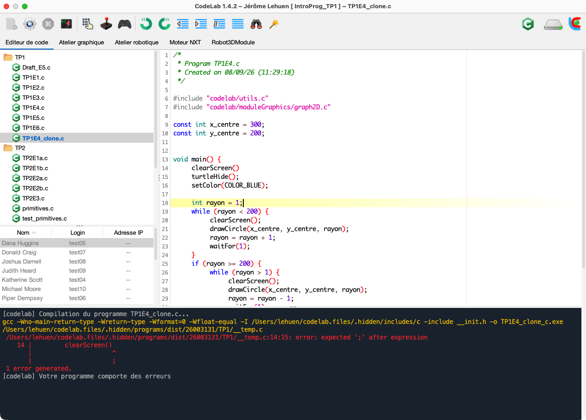

# ⚡ Quickstart Guide

> **Want to use CodeLab right away without reading the full documentation?**  
> This express guide gets you up and running, writing, and executing your first program in **under 2 minutes flat**.

---

## 1. Download and Launch (1 Click)

CodeLab is delivered as a self-contained application with its own bundled runtime (no manual Java or compiler installation needed).

Download the package tailored for your operating system from the [official Releases page](https://github.com/jlehuen/CodeLab/releases/latest):

- 🪟 **Windows**: Download [**`CodeLab-Win64-Setup.exe`**](https://github.com/jlehuen/CodeLab/releases/latest/download/CodeLab-Win64-1.5.2-Setup.exe).  
  *Run the installer (if the blue Windows SmartScreen alert appears, click "More info" then "Run anyway").*
- 🍏 **macOS**: Download [**`CodeLab-MacOS-Silicon.dmg`**](https://github.com/jlehuen/CodeLab/releases/latest/download/CodeLab-MacOS-Silicon-1.5.2.dmg) (Apple Silicon) or [**`CodeLab-MacOS-Intel.dmg`**](https://github.com/jlehuen/CodeLab/releases/latest/download/CodeLab-MacOS-Intel-1.5.2.dmg) (Intel).  
  *Drag `CodeLab.app` into Applications. On first launch, right-click > Open to authorize opening.*
- 🐧 **Linux**: Download [**`CodeLab-Linux.zip`**](https://github.com/jlehuen/CodeLab/releases/latest/download/CodeLab-Linux-1.5.2.zip).  
  *Extract the archive and run `./codelab.sh`.*

---

## 2. Interface at a Glance

<p align="center">
  
</p>

1. **Module Tabs (top)**: switch between the main code editor and interactive simulators (2D Lego Robotics, NXT Motor Simulator, 2D Vector Drawing, 3D Robotics, etc.).
2. **Toolbar (top)**: green **▶️ Run** button (shortcut `F5`) and red **⏹️ Stop** button (`Shift + F5`).
3. **Code Editor (center)**: workspace for writing code with syntax highlighting and auto-completion.
4. **Console (bottom)**: real-time output display and error logging.

---

## 3. Your First Code in 30 Seconds

Pick your language of choice:

### In Python
1. Menu **File > New > Python File** (or open any `.py` script).
2. Enter:
   ```python
   print("Welcome to CodeLab!")
   for i in range(1, 6):
       print(f"Step {i}: running seamlessly.")
   ```
3. Click **▶️ Run** (or press **`F5`**).
4. Watch the output print immediately in the bottom console!

### In C Language
1. Menu **File > New > C File**.
2. Enter:
   ```c
   #include <stdio.h>

   int main() {
       printf("Welcome to CodeLab!\n");
       for (int i = 1; i <= 5; i++) {
           printf("Step %d: running seamlessly.\n", i);
       }
       return 0;
   }
   ```
3. Click **▶️ Run** (`F5`): CodeLab compiles and executes automatically.

### In Block-Based Mode
1. Select **Blocks** mode.
2. Drag and drop a display block into the workspace.
3. Click **▶️ Run**: perfect for learning algorithms without syntax hurdles.

---

## 4. Test an Interactive Simulator in 1 Click

To explore a simulator without writing boilerplate code:

1. Click **File > Templates**.
2. Select a ready-to-run sample (e.g. **Mobile Robotics** or **NXT Motor**).
3. The sample code loads and the simulator tab activates.
4. Click **▶️ Run** (`F5`): watch the mobile robot or motor axle animate in real time!

---

## 5. Essential Shortcuts

| Shortcut | Action |
| :--- | :--- |
| **`F5`** | **Run** active program |
| **`Shift + F5`** | **Stop** current execution |
| **`Ctrl + N`** (or `Cmd + N`) | Create a **new file** |
| **`Ctrl + S`** (or `Cmd + S`) | **Save** active file |
| **`Ctrl + O`** (or `Cmd + O`) | **Open** a file |

---

📖 For more details, explore the [**Full CodeLab Documentation**](https://jlehuen.github.io/CodeLab/doc-en/).
