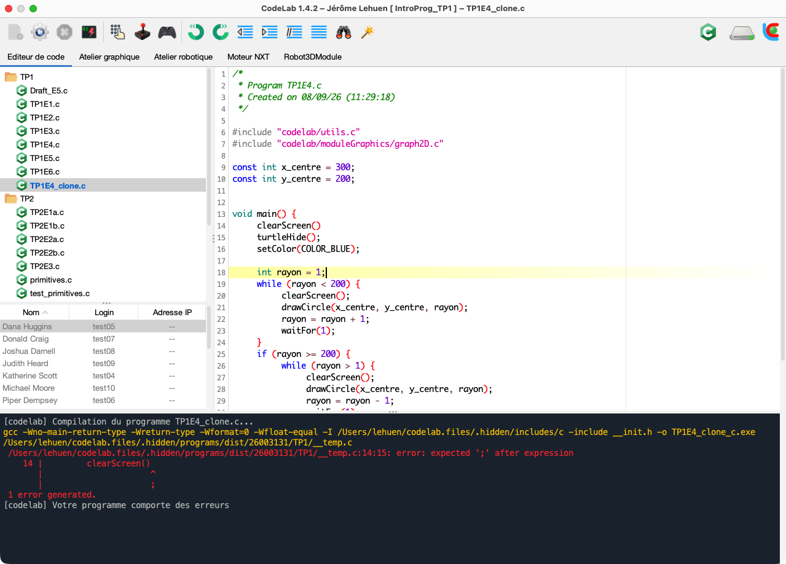

# ⚡ Guide de Démarrage Rapide (Quickstart)

> **Vous voulez utiliser CodeLab immédiatement sans lire toute la documentation ?**  
> Ce guide express vous permet de lancer l'environnement et d'exécuter votre premier programme en **moins de 2 minutes chrono**.

---

## 1. Télécharger et lancer (en 1 clic)

CodeLab est fourni avec son propre environnement d'exécution autonome (aucun prérequis de Java ou de compilateur n'est nécessaire).

Téléchargez la version correspondant à votre système depuis les [Releases officielles](https://github.com/jlehuen/CodeLab/releases/latest) :

- 🪟 **Windows** : Téléchargez [**`CodeLab-Win64-Setup.exe`**](https://github.com/jlehuen/CodeLab/releases/latest/download/CodeLab-Win64-1.5.2-Setup.exe).  
  *Lancez l'installeur (si l'écran bleu SmartScreen apparaît, cliquez sur « Informations complémentaires » puis « Exécuter quand même »).*
- 🍏 **macOS** : Téléchargez [**`CodeLab-MacOS-Silicon.dmg`**](https://github.com/jlehuen/CodeLab/releases/latest/download/CodeLab-MacOS-Silicon-1.5.2.dmg) (Apple Silicon) ou [**`CodeLab-MacOS-Intel.dmg`**](https://github.com/jlehuen/CodeLab/releases/latest/download/CodeLab-MacOS-Intel-1.5.2.dmg) (Intel).  
  *Glissez `CodeLab.app` dans Applications. À la première ouverture, faites un clic droit > Ouvrir pour autoriser le lancement.*
- 🐧 **Linux** : Téléchargez [**`CodeLab-Linux.zip`**](https://github.com/jlehuen/CodeLab/releases/latest/download/CodeLab-Linux-1.5.2.zip).  
  *Décompressez l'archive et lancez `./codelab.sh`.*

---

## 2. L'interface en un coup d'œil

<p align="center">
  
</p>

1. **Onglets de modules (en haut)** : basculez entre l'éditeur de code et les simulateurs interactifs (Robotique Lego, Simulateur moteur, Tracé 2D, Robotique 3D, etc.).
2. **Barre d'outils (en haut)** : bouton vert **▶️ Exécuter** (raccourci `F5`) et bouton rouge **⏹️ Arrêter** (`Maj + F5`).
3. **Éditeur de code (au centre)** : zone d'écriture du code source avec coloration et auto-complétion.
4. **Console (en bas)** : affichage direct des sorties texte et des messages d'erreur.

---

## 3. Votre premier code en 30 secondes

Choisissez votre langage préféré :

### En Python
1. Menu **Fichier > Nouveau > Fichier Python** (ou ouvrez un fichier `.py`).
2. Saisissez :
   ```python
   print("Bienvenue dans CodeLab !")
   for i in range(1, 6):
       print(f"Étape {i} : tout fonctionne parfaitement.")
   ```
3. Cliquez sur **▶️ Exécuter** (ou appuyez sur **`F5`**).
4. Le résultat s'affiche instantanément dans la console inférieure !

### En Langage C
1. Menu **Fichier > Nouveau > Fichier C**.
2. Saisissez :
   ```c
   #include <stdio.h>

   int main() {
       printf("Bienvenue dans CodeLab !\n");
       for (int i = 1; i <= 5; i++) {
           printf("Étape %d : tout fonctionne parfaitement.\n", i);
       }
       return 0;
   }
   ```
3. Cliquez sur **▶️ Exécuter** (`F5`) : CodeLab compile et exécute automatiquement.

### Par assemblage de blocs
1. Sélectionnez le mode **Blocs**.
2. Glissez un bloc d'affichage dans l'espace de travail.
3. Cliquez sur **▶️ Exécuter** : idéal pour s'initier aux algorithmes sans contrainte de syntaxe.

---

## 4. Tester un simulateur en 1 clic

Pour voir un simulateur s'animer sans écrire de code :

1. Cliquez sur le menu **Fichier > Modèles**.
2. Choisissez un exemple clé en main (par exemple **Robotique mobile** ou **Moteur NXT**).
3. Le code d'exemple se charge et l'onglet du simulateur s'active.
4. Cliquez sur **▶️ Exécuter** (`F5`) : admirez le robot mobile ou l'axe du moteur s'animer en direct !

---

## 5. Raccourcis indispensables

| Raccourci | Action |
| :--- | :--- |
| **`F5`** | **Exécuter** le programme actif |
| **`Maj + F5`** (ou `Shift + F5`) | **Arrêter** l'exécution en cours |
| **`Ctrl + N`** (ou `Cmd + N`) | Créer un **nouveau fichier** |
| **`Ctrl + S`** (ou `Cmd + S`) | **Enregistrer** le fichier |
| **`Ctrl + O`** (ou `Cmd + O`) | **Ouvrir** un fichier |

---

📖 Pour aller plus loin, consultez la [**Documentation complète CodeLab**](https://jlehuen.github.io/CodeLab/doc-fr/).
