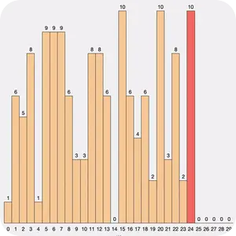
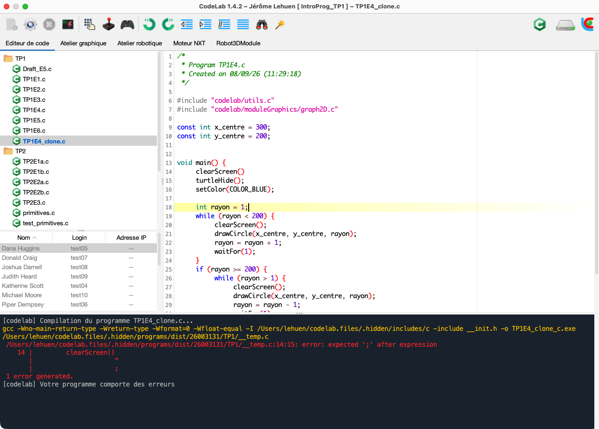
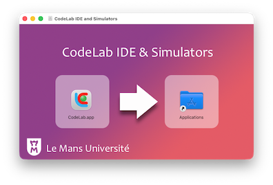
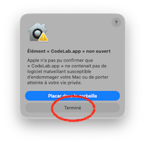
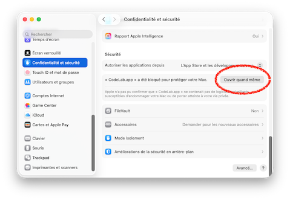
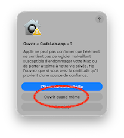
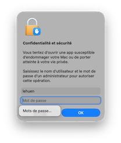
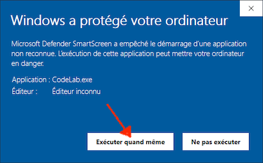
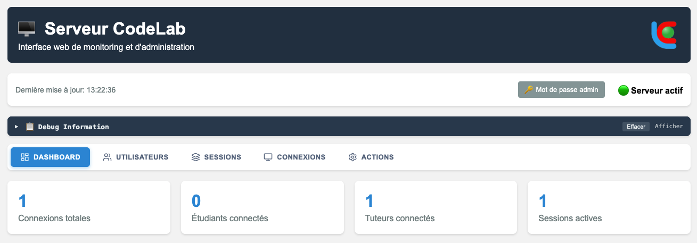

<p align="right">
  🌐 <a href="README.md">Français</a> &nbsp;|&nbsp; <strong>English</strong>
</p>

<p align="center">
  
</p>

<h1 align="center">CodeLab IDE & Simulators</h1>

<div align="center">


<!--
[](https://www.rust-lang.org/)
[](https://www.app.asso.fr/)
-->

</div>

<p align="center">
  <strong>Programming Learning Environment
  <br>for Secondary and Higher Education</strong>
  <br>
  <br>Official website: <a href="https://codelab.univ-lemans.fr">https://codelab.univ-lemans.fr</a> &nbsp;|&nbsp; 📖 <a href="https://jlehuen.github.io/CodeLab/doc-en/">Documentation</a>
  <br><br>
  <a href="#downloads"></a>
</p>

**CodeLab** is an educational programming environment dedicated to teaching and learning programming in middle schools, high schools, and introductory higher education courses. Its key innovation is offering playful and interactive alternatives to traditional screen-keyboard interactions for pedagogical activities through "application modules". These modules, available as plugins, include **visualizations**, **control panels**, **simulators**, and other real-time systems. Each module pairs a **GUI** (Graphical User Interface) with an application programming interface (**API**) available across all languages supported by CodeLab. Learners can thus focus on algorithms and coding while interacting with rich, engaging, and motivating applications:

<p align="center">
  &nbsp;&nbsp;
  &nbsp;&nbsp;
  &nbsp;&nbsp;
  
</p>

CodeLab supports a wide spectrum of **programming paradigms** (imperative, functional, object-oriented, declarative) aligned with computer science curricula (such as the French High School NSI specialty). In addition to traditional languages, CodeLab features a "block-based" visual language that lets beginners discover programming structures free from syntax constraints, an interactive native visual editor for **Jupyter notebooks (.ipynb)** supporting Python and **progressive C**, as well as an **AI-assisted automated pedagogical assessment system** (deterministic AST/Clang audits, code anti-pattern detection, formative LLM syntheses) viewable directly in a **native Markdown viewer** with HTML5 rendering.

A key feature of CodeLab is enabling **virtual classrooms** (in-person or remote) via a dedicated client-server architecture. The user / group / session model accommodates flexible lab groups supervised by one or more instructors. Instructors can **monitor learner progress in real time**, test student programs, communicate via integrated instant messaging, disconnect users at the end of class, and more.

<br>

<p align="center">
  
</p>

<br>

## Table of Contents

- [Downloads](#downloads)
- [Documentation](#documentation)
- [Language Setup](#language-setup)
- [Application Modules Setup](#application-modules-setup)
- [Automated Pedagogical Evaluation & AI](#automated-pedagogical-evaluation--ai)
- [Building Client and Server](#building-client-and-server)
  - [1. Building the Java Client](#1-building-the-java-client)
  - [2. Building the Rust Server](#2-building-the-rust-server)
- [Server Administration](#server-administration)
- [License & Intellectual Property](#license--intellectual-property)

<br>

<a id="downloads" name="downloads"></a>

## Downloads (version 1.5.2)

<br>

<p align="center">
  <a href="https://github.com/jlehuen/CodeLab/releases/latest/download/CodeLab-MacOS-Silicon-1.5.2.dmg"></a>
  &emsp;
  <a href="https://github.com/jlehuen/CodeLab/releases/latest/download/CodeLab-Win64-1.5.2-Setup.exe"></a>
  &emsp;
  <a href="https://github.com/jlehuen/CodeLab/releases/latest/download/CodeLab-Linux-1.5.2.zip"></a>
</p>

All available releases can be found in the CodeLab [Releases](https://github.com/jlehuen/CodeLab/releases) section.

<details>
<summary>
<b>macOS: First-launch authorization procedure (Gatekeeper)</b>
</summary>
<br>

> macOS blocks applications that do not have a paid Apple Developer certificate on first launch. This procedure is required **only once**:

| 1. Install | 2. First Block | 3. System Settings | 4. Confirm | 5. Password |
| :---: | :---: | :---: | :---: | :---: |
|  |  |  |  |  |
| Drag **CodeLab.app** into the **Applications** folder. | Click **Done** when macOS prevents opening. | In **System Settings** > **Privacy & Security**, click **Open Anyway**. | Relaunch CodeLab and click **Open Anyway**. | Enter your administrator password to validate. |

> 💡 **Command-line alternative**: you can also bypass the block in Terminal using the command `xattr -cr /Applications/CodeLab.app` or use the free [Sentinel](https://github.com/alienator88/Sentinel) app available on GitHub.

</details>

<details>
<summary>
<b>Windows: Installer authorization procedure (SmartScreen)</b>
</summary>
<br>

> Microsoft Defender SmartScreen blocks newly downloaded installers that do not carry a commercial Microsoft Authenticode certificate by default. This validation is required **only once during installation** (no administrator rights required):

| Instructions | &emsp;&emsp;&emsp;&emsp;&emsp;&emsp;Preview&emsp;&emsp;&emsp;&emsp;&emsp;&emsp; |
| :--- | :---: |
| 1. On the *"Windows protected your PC"* screen, click the **More info** link.<br><br>2. Then click the **Run anyway** button that appears at the bottom.<br><br>3. The installation runs within your user session; thereafter, the Start Menu shortcut will launch CodeLab directly without any security prompt. |  |

</details>

<p align="center">
  <br>
  
</p>

## Documentation

The interactive CodeLab documentation is available online at **[https://jlehuen.github.io/CodeLab/doc-en/](https://jlehuen.github.io/CodeLab/doc-en/)** (or directly in the Markdown source directory [`mkdocs/doc-en/`](mkdocs/doc-en/)):

- **Language API References**:
  - [C Language API](mkdocs/doc-en/docs/lang-c/doc-c-en.md)
  - [Java Language API](mkdocs/doc-en/docs/lang-java/doc-java-en.md)
  - [Python Language API](mkdocs/doc-en/docs/lang-python/doc-py-en.md)
  - [CLIPS Language API](mkdocs/doc-en/docs/lang-clips/doc-clips-en.md)
- **Developer Tutorials (Designing Application Modules)**:
  - [Tutorial #1: Designing a First CodeLab Module](mkdocs/doc-en/docs/tuto1/tuto1-en.md)
  - [Tutorial #2: Designing a 2D Plotter Module](mkdocs/doc-en/docs/tuto2/tuto2-en.md)
  - [Tutorial #3: Designing a Motor Simulator](mkdocs/doc-en/docs/tuto3/tuto3-en.md)

<p align="center">
  <br>
  
</p>

## Language Setup

CodeLab supports multiple programming languages: some are bundled directly with CodeLab (Java, Processing, CLIPS), some may already be installed on your machine (such as C or Python), and others can be easily installed. When you launch CodeLab, the console displays the status of available languages:

```
[codelab] Checking C language...OK -> Apple clang version 21.0.0 (clang-2100.1.1.101)
[codelab] Checking Go language...unavailable
[codelab] Checking Java language...OK -> javac 17.0.20.1
[codelab] Checking Python language...OK -> Python 3.13.15
[codelab] Checking Numpy package...OK -> Numpy version 2.3.0
[codelab] Checking Matplotlib package...OK -> Matplotlib version 3.10.3
[codelab] Checking Processing language...OK -> Processing version 4.3
[codelab] Checking Haskell language...unavailable
[codelab] Checking CLIPS language...OK -> CLIPS version 6.31 - CodeLab build (04/12/23)
```

> 💡 **Automatic discovery**: If a language already installed on your system is marked as unavailable, use the **Configuration > Search for a language** menu to detect and configure it automatically.

If a language is missing from your machine, you can install it following the instructions below:

<details>
<summary><b>Install a C compiler</b></summary>
<br>

> Coming soon!
</details>

<details>
<summary><b>Install Python + Numpy + Matplotlib</b></summary>
<br>

> A Python virtual environment (venv) is an isolated folder where you can install packages and run Python code without interfering with other system Python distributions or projects. Start by installing a recent Python release on your system (if not already installed) from the official [Python website](https://www.python.org).

> To create a virtual environment on Linux / macOS:

```bash
$ cd
$ python -m venv my_python
$ source my_python/bin/activate
(my_python) $ pip install --upgrade pip
(my_python) $ pip install numpy matplotlib
```

> To create a virtual environment on Windows:

```bash
$ cd ~
$ python -m venv my_python
$ .\my_python\Scripts\Activate.ps1
(my_python) $ pip install --upgrade pip
(my_python) $ pip install numpy matplotlib
```

> Then configure CodeLab via the menu: **Configuration > Search for a language > Python interpreter**.

> If you encounter the error **FigureCanvasAgg is non-interactive, and thus cannot be shown** when running a script, the Tk graphics library is missing. Run these commands in a terminal and relaunch CodeLab:

```bash
sudo apt update
sudo apt install python3-tk
```
> Then force the **TkAgg** backend at the beginning of your script if necessary:

```python
import matplotlib
matplotlib.use('TkAgg')
import matplotlib.pyplot as plt
```
</details>

<p align="center">
  <br>
  
</p>

## Application Modules Setup

CodeLab can be extended with **application modules** downloadable as plugins (`.pac`). Each module provides a dedicated graphical interface and a multi-language API (C, Go, Java, Python, CLIPS, etc.) to design engaging activities (2D/3D robotics, motor servo control, sorting algorithm visualization, etc.).

The complete catalog, source archives (`.zip`), precompiled packages (`.pac`), and the guide for creating new modules with the CDK are available in the [plugins/](plugins/) directory:

| Application Module | Source Code | Plugin (`.pac`) |
| :--- | :---: | :---: |
| **Hello World** (introductory first module) | [HelloModule.zip](plugins/downloads/HelloModule.zip) | [HelloModule.pac](plugins/downloads/HelloModule.pac) |
| **2D Plotter** (geometric vector drawing) | [DrawingModule.zip](plugins/downloads/DrawingModule.zip) | [DrawingModule.pac](plugins/downloads/DrawingModule.pac) |
| **NXT Motor** (simulator & servo control) | [MotorModule.zip](plugins/downloads/MotorModule.zip) | [MotorModule.pac](plugins/downloads/MotorModule.pac) |
| **Sorting Lab** (bubble/quick sort visualization) | [SortingModule.zip](plugins/downloads/SortingModule.zip) | [SortingModule.pac](plugins/downloads/SortingModule.pac) |
| **Graphic Workshop** (Logo vector turtle) | [TurtleModule.zip](plugins/downloads/TurtleModule.zip) | [TurtleModule.pac](plugins/downloads/TurtleModule.pac) |
| **3D Robot** (5-axis articulated arm 3D kinematics) | [Robot3DModule.zip](plugins/downloads/Robot3DModule.zip) | [Robot3DModule.pac](plugins/downloads/Robot3DModule.pac) |
| **Algorithmic Dungeon** (mazes, keys and treasures) | [DungeonModule.zip](plugins/downloads/DungeonModule.zip) | [DungeonModule.pac](plugins/downloads/DungeonModule.pac) |

> 📖 Consult the [plugin manual](plugins/README.md) for detailed instructions on installation, compilation, and module creation using the CDK (*CodeLab Development Kit*).

<p align="center">
  <br>
  
</p>

## Automated Pedagogical Evaluation & AI

CodeLab integrates a modular **continuous formative assessment** system (*skills*), built upon a hybrid methodology combining the rigor of local static analysis with personalized pedagogical feedback.

### 1. A Hybrid & Deterministic Methodology
- **Local static analysis (100% offline)**: Student code is first analyzed locally without any network requests (syntax checking, AST syntax tree analysis, learning milestones validation, and code anti-pattern detection).
- **Absolute scoring integrity**: The 20-point grade is calculated deterministically through objective local rules. **It is strictly identical with or without AI**.
- **Realistic calibration**: The rubric avoids grade inflation: progress is evaluated based on demonstrated autonomy and completed milestones, guaranteeing a fair assessment representative of the student's true level.

### 2. Authenticity Detection & Plagiarism Control
- **AI assistance detection**: Multi-criteria analysis cross-referencing ecosystem compliance (detecting out-of-curriculum libraries or constructs), development timeline, and stylometric indentation breaks.
- **Peer similarity detection**: Automated copy-paste detection between students (Winnowing algorithm and syntactic n-grams), generating a similarity matrix and cohort report.

### 3. Role of AI: Benevolent Socratic Guidance
Currently, only **Google Gemini** is implemented. When an API key is configured:
- **Targeted diagnosis**: The AI only receives factual data (fixed scores, validated milestones, and short targeted code snippets).
- **Socratic posture**: The AI does not assign grades; it is solely tasked with writing the individual student report adopting a supportive, caring instructor stance. It asks open-ended questions and guides students toward self-remediation rather than handing out raw solutions.
- **Performance & Cache**: Operates within Google AI Studio's Free Tier quotas. A persistent local cache avoids consuming requests if the student's code has not changed.

### 4. Instructor Feedback & Reports
- **Individual Markdown reports** viewable directly within CodeLab or in a web browser.
- **Cohort summary & CSV export** generated instantly for grade recording.

> 📖 To learn more about architecture, API configuration, and authoring new assessment rubrics, consult the [evaluation skills guide](client/codelab.files/skills/README.md).

<p align="center">
  <br>
  
</p>

## Building Client and Server

### Project Architecture

```text
codelab/
├── client/                     # Java client application
│   ├── src/                    # Java source code (codelab package)
│   │   ├── client/             # Client-server network protocol (MessagePack)
│   │   ├── controllers/        # Device controllers (JInput, joysticks, etc.)
│   │   ├── modules/            # Interactive modules and PAC simulators
│   │   └── utils/              # Cryptography, parsers, Tar/Zstd compression
│   ├── data/                   # Graphics, sounds, language syntax resources
│   ├── hidden/codelab/         # Third-party libraries (FlatLaf, JInput, etc.)
│   ├── natives/                # Native C/C++ libraries per OS (.dylib, .so, .dll)
│   ├── build.xml               # Apache Ant build file
│   ├── build.sh                # Local build script
│   └── distrib-*.sh            # Packaging scripts (macOS, Linux, Windows)
│
├── plugins/                    # Downloadable application modules & simulators
│   ├── downloads/              # Precompiled binaries (.pac) and sources (.zip)
│   └── README.md               # Catalog, installation, and CDK guide
│
├── server/                     # Infrastructure server
│   ├── server/                 # Asynchronous Rust server (Tokio)
│   │   ├── src/                # Rust source code (main, database, network, admin)
│   │   ├── config/             # Configuration templates (server.properties, sessions.xml)
│   │   └── Cargo.toml          # Cargo dependencies and metadata
│   ├── run-server.sh           # Service startup script
│   └── kill-server.sh          # Clean service shutdown script
│
├── VERSION                     # Single source of truth for version numbering
├── .gitignore
├── .gitattributes
├── .editorconfig
├── LICENSE
└── README.md
```

### 1. Building the Java Client

#### Build Prerequisites
- **Java Development Kit (JDK) 17 LTS** installed and configured (`JAVA_HOME`)
- **Apache Ant 1.10+** (or use the bundled Ant executable in `client/java/`)

#### Compilation
```bash
cd client
./build.sh
```
The resulting binary is generated in `client/hidden/codelab/codelab.jar`.

#### Generating Standalone Distributions

> [!NOTE]
> **Why are JDK runtimes excluded from the Git repository?**  
> Complete Java runtime environments exceed GitHub's per-file size limit (internal `lib/modules` files > 100 MB) and would bloat the repository by over 1.5 GB. They are therefore deliberately excluded via `.gitignore`.

To build standalone, ready-to-run distributions (bundling their own JVM without external dependencies for end users), first download the official **JDK 17 LTS** archives from [Adoptium Temurin Releases](https://adoptium.net/temurin/releases/?version=17) and extract them into their respective folders:

| OS | Official Archive | Format | Target Directory in `client/` |
| :--: | :--: | :--: | :--- |
|  | [macOS aarch64 (JDK 17)](https://adoptium.net/temurin/releases/?version=17&os=mac&arch=aarch64&package=jdk) | `.tar.gz` | `mac-app-arm/Contents/Java/jdk-17.0.20.1+1/` |
|  | [macOS x64 (JDK 17)](https://adoptium.net/temurin/releases/?version=17&os=mac&arch=x64&package=jdk) | `.tar.gz` | `mac-app-x64/Contents/Java/jdk-17.0.8.1+1/` |
|  | [Windows x64 (JDK 17)](https://adoptium.net/temurin/releases/?version=17&os=windows&arch=x64&package=jdk) | `.zip` | `java/windows_64/JDK-17.0.8.1+1/` |
|  | [Linux x64 (JDK 17)](https://adoptium.net/temurin/releases/?version=17&os=linux&arch=x64&package=jdk) | `.tar.gz` | `java/linux_64/JDK-17.0.8.1+1/` |

> [!TIP]
> If you download a newer minor release of Temurin 17 (e.g. `jdk-17.0.14+7`), simply rename the extracted folder to match the name in the table above (or create a symbolic link) so that the packaging scripts and launchers detect it automatically.

Once the JDKs are in place, run the script for your target platform:
- **macOS** (Universal DMG for Apple Silicon & Intel): `./distrib-mac.sh`
- **Linux** (Standalone FreeDesktop archive): `./distrib-linux.sh`
- **Windows** (NSIS Installer): `./distrib-win64-nsis.sh`

### 2. Building the Rust Server

The CodeLab server orchestrates virtual classrooms, manages bidirectional streams between learners and instructors, and provides a web supervision dashboard.

#### Architecture & Technical Highlights
- **Asynchronous Actor Model (Tokio)**: Engineered to handle hundreds of concurrent sessions with minimal memory footprint, featuring graceful shutdown.
- **Optimized Binary Protocol**: Compact, high-throughput network exchanges serialized with **MessagePack** over TCP sockets.
- **Web Administration Dashboard**: Integrated browser-accessible interface (HTTP Basic) allowing real-time monitoring of connected learners, group inspection, and remote disconnects.
- **Persistence & Security**: Declarative XML session, instructor, and student configuration (`sessions.xml`), with isolated student workspaces on the filesystem.
- **Automated Backups**: Timestamped backup rotation with high-performance **TAR + Zstandard** (`.tar.zst`) compression.

#### Build Prerequisites
- [Rust & Cargo](https://rustup.rs/) toolchain (2021 stable edition)

#### Initial Configuration
Create your local configuration files from the provided sample templates:
```bash
cd server/server
cp config/server.properties.example config/server.properties
cp config/sessions.example.xml config/sessions.xml
```

*Note: For security and GDPR compliance, actual `server.properties` and `sessions.xml` files are strictly ignored by Git.*

#### Starting the Server

##### Development Mode
```bash
cd server/server
cargo run
```

##### Production Mode (Optimized Binary)
```bash
cd server/server
cargo build --release
./target/release/server
```

The server listens on the addresses configured in `server.properties`:
- **TCP Port (e.g. 9988)**: Network connections from student and instructor clients.
- **HTTP Port (e.g. 9989)**: Web administration dashboard (`http://127.0.0.1:9989`). Credentials are set in `server.properties` (`admin` login and SHA-256 password hash).

Service scripts are also provided in the `server/` directory:
- `./run-server.sh`: Starts the server in the background.
- `./kill-server.sh`: Cleanly stops the server process.

<p align="center">
  <br>
  
</p>

## Server Administration

The CodeLab server includes a built-in web administration console and automated tools to manage virtual classrooms without external dependencies:

<p align="center">
  <br>
  
</p>

### Web Administration Dashboard
- **Access**: `http://localhost:9989` *(or server IP address)*.
- **Authentication**: HTTP Basic (account configured in `server.properties` with SHA-256 hashed password).
- **Key Features**:
  - **Real-time supervision**: Monitor connected students and instructors, their IP addresses, elapsed working time, and active session.
  - **Session management**: Open and close access to lab sessions with a single click.
  - **Hot group reassignment**: Seamlessly transfer a student from one group to another in memory without disconnection or code loss.
  - **Control and forced logout** of stalled sessions.

### Preparing Users and Sessions (`sessions.xml`)
The list of groups, sessions, and authorized users is declared in `sessions.xml` (validated by `sessions.dtd`). To automatically convert student rosters (`.xlsx` or `.csv` files) into ready-to-insert XML fragments:
- **macOS / Linux**: run `./build-xml.sh` in `server/server/config/data/` (interactive mode).
- **Windows**: simply drag-and-drop your `users.xlsx` file onto the `build-xml.bat` icon.
- **Cross-platform**: `python build-xml.py [source.xlsx|csv]`.
- **DTD Validation**: verify XML syntax and validity via `./xml-validator.sh sessions.xml`.

### Service Scripts
From the `server/` directory:
- `./run-server.sh`: starts the server as a background process with port availability check.
- `./kill-server.sh`: cleanly terminates the service, flushing disk writes and disconnecting clients gracefully.
- `./update-server.sh`: securely synchronizes modified files to the remote server, strictly preserving student databases, XML files, and active sessions.

> 📖 **Full Documentation**: For advanced technical details (Tokio async architecture, SMTP alert configuration, timeout management, automated backup rotation, and GDPR compliance), consult the [full server manual](server/README.md).

<p align="center">
  <br>
  
</p>

## License & Intellectual Property
 
- **Author**: Jérôme Lehuen, Associate Professor (Maître de Conférences) at [Le Mans Université](https://www.univ-lemans.fr).
- **Terms of Use**: This software (source code and binaries) is provided free of charge for educational and academic purposes. **Any commercial use, exploitation, or sublicensing is strictly prohibited** without prior written agreement from the author and Le Mans Université.
- **Legal Deposit**: CodeLab is registered with the [Agence pour la Protection des Programmes](https://www.app.asso.fr/) (APP) under reference IDDN-FR-001-260031-000-SC-2022-000-10000.
- **License**: Refer to the [LICENSE](LICENSE) file for complete terms and legal notices.
- **Copyright**: © 2021-2026 Jérôme Lehuen, Le Mans Université.

<p align="center">
  
  <br/>IDDN-FR-001-260031-000-SC-2022-000-10000
</p>
