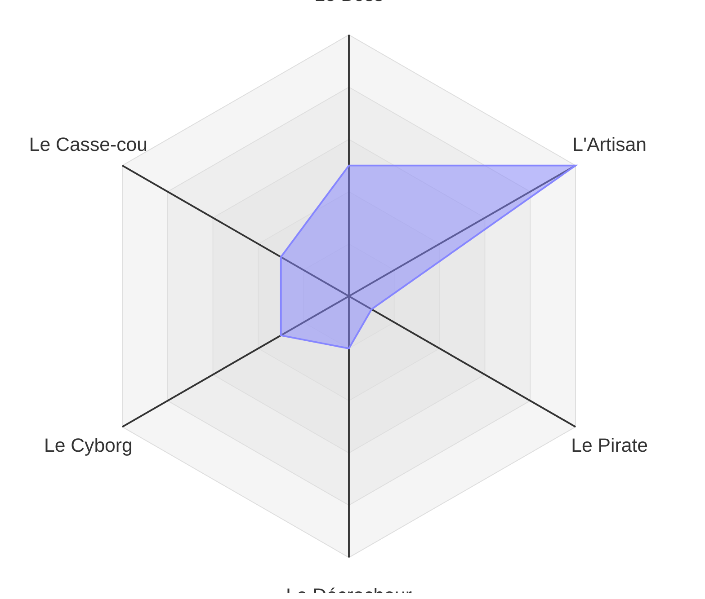

# Compétences & Évaluation Pédagogique CodeLab

Ce répertoire rassemble le moteur d'évaluation et les compétences (*skills*) pédagogiques pour l'environnement **CodeLab**.

> [!IMPORTANT]
> **Modèles génériques : utilisables immédiatement, et pensés pour être spécialisés**  
> Les 4 compétences fournies ici (`eval-c-sample`, `eval-python-sample`, `eval-haskell-sample`, `eval-java-sample`) sont **pleinement opérationnelles et exploitables telles quelles** pour le suivi formatif de séances de TP (fichiers sources et carnets `.ipynb` pour C, Python et Haskell) : compilation/syntaxe, qualité de conception, style, télémétrie, double radar, détection de plagiat et d'assistance IA.
>
> **Attention** : les skills génériques ne connaissent pas votre énoncé, ils n'évaluent pas la **justesse fonctionnelle métier** des algorithmes attendus ni des consignes spécifiques de cursus. Pour un contrôle noté ou un TP ciblé, dupliquez le modèle adapté (**CodeLab → Skills d'évaluation → Nouveau skill depuis un modèle…**) et ajoutez vos consignes (`SKILL.md`), votre barème (`weights.json`) et, si besoin, un banc de tests fonctionnels (`tests.json`).

---

## 1. Organisation du Répertoire

```
skills/
├── eval_codelab.py         # Moteur universel d'évaluation (CLI & interface CodeLab)
├── skills_common.py        # Module partagé (weights.json, .ipynb, compilateurs, Jaccard, tests.json)
├── activity_analyzer.py    # Moteur d'analytics télémétriques, double radar et 6 profils
├── recalculate_grades.py   # Utilitaire de recalcul des barèmes hors-ligne
├── generate_session_test.py# Générateur de cohortes d'étalonnage à 10 profils
├── README.md               # Guide d'architecture et de référence (ce fichier)
│
├── eval-c-sample/          # Exemple générique C (.c, .h, .ipynb C)
├── eval-python-sample/     # Exemple générique Python (.py, .ipynb Python)
├── eval-haskell-sample/    # Exemple générique Haskell (.hs, .ipynb Haskell)
└── eval-java-sample/       # Exemple générique Java (.java, POO, Javadoc, Tests)
```

### Documentation détaillée des 4 modèles génériques
*(Cliquez directement sur un lien ci-dessous pour l'ouvrir dans le visualiseur Markdown de CodeLab)* :

- **C / Algorithmique** : [eval-c-sample/README.md](eval-c-sample/README.md) · [SKILL.md](eval-c-sample/SKILL.md)
- **Python / Algorithmique** : [eval-python-sample/README.md](eval-python-sample/README.md) · [SKILL.md](eval-python-sample/SKILL.md)
- **Haskell / Programmation Fonctionnelle** : [eval-haskell-sample/README.md](eval-haskell-sample/README.md) · [SKILL.md](eval-haskell-sample/SKILL.md)
- **Java / POO** : [eval-java-sample/README.md](eval-java-sample/README.md) · [SKILL.md](eval-java-sample/SKILL.md)

### Banc de tests fonctionnels déclaratif optionnel (`tests.json`)
Tout skill spécialisé peut inclure un fichier optionnel `tests.json` à sa racine pour automatiser la notation de l'Axe 4 (Validation) sans écrire de code Python :

```json
{
  "timeout": 3,
  "tests": [
    { "name": "Factorielle 5", "file": "algo.py", "expr": "fact(5)", "expected": "120" },
    { "name": "Entrée standard", "file": "main.c", "stdin": "4\n", "expected_stdout": "24" }
  ]
}
```

### Gestion directe depuis CodeLab
Toutes les actions de gestion sont regroupées dans le menu principal **CodeLab → Skills d'évaluation** (sous *Configuration*) :
- **Documentation des skills** : ouvre ce guide dans le visualiseur Markdown intégré.
- **Nouveau skill depuis un modèle…** : duplique l'un des 4 `*-sample` dans `~/codelab.files/skills/` et ouvre `SKILL.md` et `weights.json`.
- **Recharger les skills** : actualise la liste des compétences à chaud sans redémarrer CodeLab.
- **Ouvrir le dossier des skills** : ouvre `~/codelab.files/skills/` dans l'explorateur système.

---

## 2. Découverte Dynamique des Compétences

CodeLab scanne automatiquement au lancement le répertoire des compétences :
`~/codelab.files/skills/`

Chaque sous-dossier contenant un fichier `SKILL.md` est instantanément reconnu et intégré dans les menus contextuels :
- **Dans le gestionnaire de fichiers (`FileManager`)** : menu contextuel *Évaluer ce dossier*.
- **Dans la table de supervision (`UserTable`)** : menus contextuels *Évaluer cet étudiant* et *Évaluer toute la session*.

---

## 3. Méthode pour Spécialiser un Skill selon vos Exercices

Pour transformer l'un des modèles génériques en une compétence dédiée à un TP, un projet ou un examen précis, suivez cette méthode en 5 étapes :

| Étape | Intitulé & Action | Fichier source / cible | Rôle pédagogique & Technique |
| :---: | :--- | :--- | :--- |
| **1** | **Dupliquer le skill** | `eval-python-sample/` $\to$ dossier cible | Initialiser la base de code du nouveau skill. |
| **2** | **Définir le sujet** | `SKILL.md` | Préciser les consignes, signatures de fonctions et contraintes. |
| **3** | **Régler le barème** | `weights.json` | Pondérer les exercices, la qualité du code et les pénalités. |
| **4** | **Coder les tests** | `audit_student.py` | Implémenter les assertions dynamiques et tests fonctionnels. |
| **5** | **Valider à blanc** | Solution enseignant | Exécuter l'évaluation sur le corrigé type pour certifier le 20/20. |

### Étape 1 : Dupliquer le modèle le plus proche
Copiez le dossier exemple correspondant au langage de votre cours vers un nouvel identifiant explicite :
```bash
cp -r eval-python-sample eval-tp3-arbres-binaires
```

### Étape 2 : Formaliser le sujet et les consignes (`SKILL.md`)
Éditez l'en-tête et les consignes du fichier `SKILL.md` :
- `name` : identifiant unique de la compétence (ex. `eval-tp3-arbres-binaires`).
- `description` : intitulé affiché dans les menus CodeLab (ex. `TP3 - Arbres Binaires de Recherche`).
- **Consignes pédagogiques** : listez les fonctions, méthodes ou structures attendues, les contraintes imposées (ex. *récursivité obligatoire*, *interdiction des modules externes*) et les erreurs fréquentes à signaler. Ce texte servira de consigne directe au modèle IA pour formuler des retours pertinents et ciblés.

### Étape 3 : Calibrer le barème (`weights.json`)
Ajustez la répartition des points selon vos priorités pédagogiques sans toucher au code Python. Le total est automatiquement ramené sur 20 points :
```json
{
  "syntaxe_compilation": 4.0,
  "architecture_modularite": 6.0,
  "style_conventions": 2.0,
  "validation_tests": 8.0
}
```

### Étape 4 : Personnaliser les contrôles d'audit (`scripts/audit_student.py`)
Spécialisez la fonction `audit_student(folder_path)` pour vérifier les éléments attendus dans le dossier de l'étudiant :
- **Présence des fonctions obligatoires** : vérifier que l'étudiant a bien défini les fonctions demandées (via l'AST en Python, les symboles en C, ou l'inspection en Java).
- **Validation dynamique** : exécuter automatiquement un jeu de tests unitaires ou de cas limites préparés par l'enseignant.
- **Vérification des contraintes** : pénaliser l'usage de fonctions interdites ou vérifier la présence d'assertions.

### Étape 5 : Valider la compétence à blanc
Avant de déployer le skill auprès des étudiants :
1. Évaluez le dossier de **votre solution de référence** : elle doit obtenir 20/20 avec tous les indicateurs au vert.
2. Évaluez un devoir test volontairement incomplet ou comportant des erreurs typiques pour vérifier la bienveillance et la pertinence des conseils générés.

---

## 4. Anatomie & Contrat d'Interface d'un Skill

Chaque compétence s'appuie sur une structure standardisée :

| Fichier / Dossier | Rôle |
| :--- | :--- |
| `SKILL.md` | Spécification formelle (`name`, `description`, consignes pédagogiques pour l'IA). |
| `weights.json` | Barème et pondération des axes d'évaluation (ex: $6 + 8 + 4 + 2 = 20$). Modifiable sans coder. |
| `report_template.md` | Modèle Markdown de la fiche individuelle générée pour chaque étudiant. |
| `scripts/audit_student.py` | Analyse statique et dynamique du dossier étudiant (validité syntaxique, modularité, métriques). |
| `scripts/generate_report.py` | Génère la fiche individuelle d'évaluation au format Markdown. |
| `scripts/audit_cohort.py` | Analyse globale de session : matrice de similarité/plagiat et export des notes au format CSV. |

---

## 5. Fonctionnement Hybride & Configuration IA

Le moteur d'évaluation CodeLab adopte une architecture **hybride et éthique** alliant la rigueur de l'analyse statique locale à la personnalisation du retour pédagogique :

### 5.1. Une Méthodologie Hybride & Déterministe
- **Analyse statique locale (100 % hors-ligne)** : Le code étudiant est d'abord analysé localement sans appel réseau (contrôle de syntaxe, analyse d'arbre syntaxique AST Python, Clang ou Javac, validation des jalons pédagogiques et détection d'anti-patterns de programmation).
- **Intégrité absolue de la notation** : La note sur 20 points est calculée de manière déterministe par des règles objectives locales. **Elle est rigoureusement identique avec ou sans IA**.
- **Calibration réaliste** : Le barème évite les notes de complaisance : la progression est évaluée selon l'autonomie démontrée et les étapes franchies, garantissant une note juste et représentative du niveau réel de l'étudiant.

### 5.2. Détection d'Authenticité & Contrôle du Plagiat
- **Détection d'assistance IA** : Analyse multi-critères croisant la conformité de l'écosystème (détection de bibliothèques ou syntaxes hors programme), la chronométrie de développement (neutralisée dès que la télémétrie prouve $S_{\mathrm{auth}} \ge 85\%$) et les ruptures stylométriques d'indentation (les scripts Python PEP 8 homogènes et les carnets `.ipynb` ne sont jamais pénalisés).
- **Similarités inter-étudiants** : Détection automatique des copier-coller entre étudiants (n-grams syntaxiques après filtrage anti-boilerplate des exercices courts/guidés), avec qualification *Forte suspicion* réservée à `>= 2` fichiers distincts ou `1` fichier substantiel (`>= 120` tokens) à `>= 92%`.
- **Politique zéro faux positif (bandeau rouge & malus indicatif)** : Aucun malus ni plafond n'est appliqué automatiquement sur la note. Les rapports affichent la **Note brute (/20)** accompagnée d'une colonne **Malus** purement indicative et d'un **bandeau d'alerte rouge** bien visible (fiche individuelle et synthèse de session), laissant la décision finale à l'enseignant après vérification humaine.

### 5.3. Rôle de l'IA : Guidance Socratique Bienveillante
Pour l'instant, seul le LLM **Google Gemini** est implémenté. Lorsqu'une clé d'API est configurée :
- **Diagnostic ciblé** : L'IA ne reçoit que le bilan factuel (scores fixés, jalons validés et courts extraits de code ciblés).
- **Posture socratique** : L'IA n'attribue pas la note, elle se charge uniquement de rédiger la fiche individuelle en adoptant une posture d'enseignant bienveillant. Elle formule des questions ouvertes et guide l'étudiant vers l'auto-remédiation plutôt que de fournir une solution brute.
- **Mode déconnecté** : En l'absence de clé API ou en cas de coupure réseau, un compte-rendu textuel déterministe est généré sans bloquer l'évaluation.

### 5.4. Configuration & Gestion du Cache

La configuration s'effectue dans `~/codelab.files/userdata/user.properties` :
```properties
GEMINI_API_KEY = votre_cle_api_google
GEMINI_MODEL   = gemini-3.5-flash-lite
AI_CACHE       = true
```

- **Cache persistant (`userdata/ai_cache/`)** : Les retours IA sont mis en cache localement par empreinte SHA-256. Réévaluer une session sans modification de code consomme **0 requête API**.
- **Invalidation automatique** : Dès qu'un étudiant modifie son code, son diagnostic change et une nouvelle analyse est déclenchée automatiquement.
- **Réinitialisation manuelle** : Pour forcer une régénération complète de tous les commentaires d'une promotion :
  ```bash
  rm -rf ~/codelab.files/userdata/ai_cache/*
  ```

---

## 6. Analyse Télémétrique, Double Radar & Typologies Didactiques

CodeLab intègre un moteur d'analyse comportementale de pointe ([`activity_analyzer.py`](activity_analyzer.py)) qui extrait des métriques objectives issues de la session de développement et les projette graphiquement sous forme de **diagrammes radar Mermaid (`radar-beta`)** nativement rendus dans l'interface CodeLab.

### 6.1. Le Double Radar Individuel

Chaque fiche d'évaluation individuelle intègre deux diagrammes radar complémentaires présentés côte à côte dans un tableau responsive :

1. **Radar des Indicateurs Clés (/20)** : évalue les 6 compétences techniques objectives :
   - `auth` : Authenticité de saisie ($S_{auth}$ issu du rapport touches frappées / volume total).
   - `focus` : Concentration dans l'environnement ($100 - I_{nav}$).
   - `debug` : Efficience de débogage et absence d'acharnement ($1 - I_{thrash}$).
   - `test` : Validation fonctionnelle et robustesse aux tests.
   - `arch` : Architecture modulaire et conception logicielle.
   - `style` : Conventions, idiomes et propreté du code (ex: PEP 8).

2. **Radar des Profils Types Didactiques (/20)** : projette le comportement d'apprentissage sur 3 couples d'archétypes opposés deux à deux :

<div align="center">
<table width="580" border="0" cellspacing="0" cellpadding="0" style="width:580px; border:none; border-collapse:collapse; margin: 10px auto;">
<tr>
  <td width="250" align="center" style="width:250px; background-color:#ecfdf5; border:2px solid #059669; color:#065f46; padding:7px 8px;"><b>Le Boss</b><br/>Résolution directe &amp; maîtrise autonome</td>
  <td width="80" align="center" style="width:80px; border:none; background:transparent; color:#475569; font-size:22px; padding:0;">&#x27F7;</td>
  <td width="250" align="center" style="width:250px; background-color:#fef2f2; border:2px solid #dc2626; color:#991b1b; padding:7px 8px;"><b>Le Décrocheur</b><br/>Inactivité prolongée &amp; abandon du code</td>
</tr>
<tr><td colspan="3" height="10" style="border:none; background:transparent; padding:0; font-size:1px;">&nbsp;</td></tr>
<tr>
  <td width="250" align="center" style="width:250px; background-color:#eff6ff; border:2px solid #2563eb; color:#1e40af; padding:7px 8px;"><b>L'Artisan</b><br/>Saisie manuelle &amp; démarche itérative</td>
  <td width="80" align="center" style="width:80px; border:none; background:transparent; color:#475569; font-size:22px; padding:0;">&#x27F7;</td>
  <td width="250" align="center" style="width:250px; background-color:#fef3c7; border:2px solid #d97706; color:#92400e; padding:7px 8px;"><b>Le Cyborg</b><br/>Injections massives &amp; recours à l'IA</td>
</tr>
<tr><td colspan="3" height="10" style="border:none; background:transparent; padding:0; font-size:1px;">&nbsp;</td></tr>
<tr>
  <td width="250" align="center" style="width:250px; background-color:#fdf4ff; border:2px solid #c026d3; color:#86198f; padding:7px 8px;"><b>Le Casse-cou</b><br/>Acharnement stérile &amp; runs impulsifs</td>
  <td width="80" align="center" style="width:80px; border:none; background:transparent; color:#475569; font-size:22px; padding:0;">&#x27F7;</td>
  <td width="250" align="center" style="width:250px; background-color:#f8fafc; border:2px solid #475569; color:#1e293b; padding:7px 8px;"><b>Le Pirate</b><br/>Import direct &amp; partage de fichiers</td>
</tr>
</table>
</div>

> [!NOTE]
> **Opposition des 3 Couples Didactiques à 180°** :
> - 👑 **Le Boss** $\longleftrightarrow$ 🚪 **Le Décrocheur** : aisance et réussite autonome face au décrochage silencieux.
> - 🔨 **L'Artisan** $\longleftrightarrow$ 🤖 **Le Cyborg** : démarche d'apprentissage authentique face à la délégation externe / IA.
> - ⚡ **Le Casse-cou** $\longleftrightarrow$ 🏴‍☠️ **Le Pirate** : combat acharné avec le code face à la collusion / copie d'autrui.

### 6.2. Le Radar de Cohorte dans les Synthèses de Session

Dans le rapport de synthèse de promotion (`synthese_*.md`), le tableau `Typologies & Répartition par Clusters d'Étudiants Types` est immédiatement complété par le **Radar de Cohorte** :
- Il reporte les effectifs réels de la promotion sur les 6 profils types opposés à 180°.
- L'échelle maximale (`max`) s'ajuste dynamiquement par paliers (5, 10, ou multiples de 5) selon la taille du groupe.
- Il permet à l'équipe pédagogique d'identifier instantanément si la séance a été dominée par une saine démarche d'apprentissage (*Artisans*), une réussite sans effort (*Boss*), des blocages massifs (*Casse-cou* / *Décrocheurs*) ou un recours marqué à des assistants externes (*Cyborgs*).

*Exemple pour une promotion fictive de 24 étudiants (5 Boss, 10 Artisans, 1 Pirate, 2 Décrocheurs, 3 Cyborgs, 3 Casse-cou) :*



### 6.3. Structure Normalisée des Fiches Individuelles

Toutes les fiches individuelles produites par les compétences CodeLab s'articulent autour d'une structure rigoureuse et harmonisée en 4 sections pédagogiques :
1. **Cartouche de Traçabilité & Synthèse d'Intégrité** : horodatage, version de la compétence, moteur d'évaluation, indices d'authenticité et d'assistance IA.
2. **Tableau Récapitulatif des Notes Calibrées** : détail par axe de compétence avec respect strict du barème officiel.
3. **Profil Visuel Multidimensionnel (Diagrammes Radar)** : rendu visuel des deux radars Mermaid et tableau diagnostique d'affinité aux 6 profils didactiques.
4. **Analyses d'Intégrité & Dynamique Temporelle** : chronométrie fine, stylométrie, tranches de 15 minutes et alertes télémétriques.
5. **Sections Pédagogiques Structurées** :
   - *Bilan de Progression & Analyse Pédagogique*
   - *Points Forts Observés*
   - *Axes d'Amélioration & Conseils Méthodologiques*
   - *Commentaire de l'Enseignant*

### 6.4. Détection & Interprétation des Doubles-Profils Didactiques Cohérents

En situation d'apprentissage en laboratoire, les apprenants ne se réduisent que rarement à un archétype unilatéral pur. Les 6 profils didactiques de CodeLab étant bâtis sur 3 axes de tension indépendants à 180°, les croisements inter-axes traduisent des **signatures comportementales complexes et cohérentes**.

#### Critères de détection algorithmique :
Le moteur télémétrique [`activity_analyzer.py`](activity_analyzer.py) identifie automatiquement un **Double-Profil Hybride** lorsque :
1. **Orthogonalité des dimensions** : Les deux profils appartiennent à des axes distincts (les pôles antagonistes comme *Boss vs Décrocheur* s'excluent mutuellement).
2. **Niveau d'affinité significatif** : Les deux scores d'affinité sont élevés ($S_1 \ge 11.0 / 20$ et $S_2 \ge 11.0 / 20$).
3. **Proximité des affinités** : L'écart entre les deux profils est resserré ($|S_1 - S_2| \le 3.5\text{ pts}$).

#### Typologie des 12 Doubles-Profils Hybrides :

| Double-Profil Détecté | Surnom Évocateur | Signification Didactique | Posture Pédagogique Conseillée |
| :--- | :--- | :--- | :--- |
| <span style="color:#059669;"><b>Boss</b></span><br/><span style="color:#2563eb;"><b>Artisan</b></span> | **L'architecte méthodique** | Excellence conceptuelle alliée à une rigueur exemplaire (saisie personnelle continue, tests réguliers). | **Valoriser** l'autonomie, **proposer** des défis d'optimisation ou du tutorat par les pairs. |
| <span style="color:#059669;"><b>Boss</b></span><br/><span style="color:#c026d3;"><b>Casse-cou</b></span> | **Le hacker instinctif** | Grande vivacité d'esprit mais développement impulsif à chaud sans formalisation préalable. | **Canaliser** vers des tests unitaires pérennes et la conception sur papier avant codage. |
| <span style="color:#2563eb;"><b>Artisan</b></span><br/><span style="color:#c026d3;"><b>Casse-cou</b></span> | **Le travailleur acharné** | Investissement honnête total (zéro triche), mais acharnement aveugle face aux erreurs bloquantes. | **Apprendre** à lire les tracebacks et **poser** des hypothèses. |
| <span style="color:#d97706;"><b>Cyborg</b></span><br/><span style="color:#c026d3;"><b>Casse-cou</b></span> | **L'apprenti sorcier** | Injection de code généré par IA non compris, suivi de modifications compulsives au hasard. | **Recadrer** méthodologiquement : **suspendre** l'IA, retour aux bases et verbalisation. |
| <span style="color:#dc2626;"><b>Décrocheur</b></span><br/><span style="color:#d97706;"><b>Cyborg</b></span> | **Le délégataire passif** | Inactivité ou passivité prolongée masquée par un code externe/IA parachuté en fin de séance. | **Organiser** un entretien individuel et une soutenance orale pour **vérifier** l'assimilation réelle. |
| <span style="color:#dc2626;"><b>Décrocheur</b></span><br/><span style="color:#c026d3;"><b>Casse-cou</b></span> | **L'épuisé découragé** | Acharnement compulsif infructueux en début de séance ayant débouché sur l'abandon. | **Déceler** la détresse plus tôt pour **intervenir** avant la rupture motivationnelle. |
| <span style="color:#059669;"><b>Boss</b></span><br/><span style="color:#d97706;"><b>Cyborg</b></span> | **L'ingénieur augmenté** | Aisance conceptuelle exploitant l'IA comme un accélérateur de productivité assumé. | **S'assurer** lors d'épreuves sur table de la capacité à coder en autonomie complète. |
| <span style="color:#475569;"><b>Pirate</b></span><br/><span style="color:#d97706;"><b>Cyborg</b></span> | **Le contrebandier numérique** | Cumul de ruptures d'intégrité : importations USB / réseau et génération par IA externe. | **Convoquer** formellement pour manquement à la charte et **réévaluer** sous surveillance. |
| <span style="color:#059669;"><b>Boss</b></span><br/><span style="color:#475569;"><b>Pirate</b></span> | **L'éclaireur partageur** | Maîtrise technique solide associée à des diffusions ou transferts de fichiers vers des tiers. | **Rappeler** la frontière déontologique entre entraide bienveillante et collusion. |
| <span style="color:#dc2626;"><b>Décrocheur</b></span><br/><span style="color:#475569;"><b>Pirate</b></span> | **Le copiste de survie** | En situation d'échec total, l'étudiant a importé la solution d'autrui pour éviter la copie blanche. | **Traiter** la cause d'incompréhension tout en **appliquant** le règlement académique. |
| <span style="color:#2563eb;"><b>Artisan</b></span><br/><span style="color:#475569;"><b>Pirate</b></span> | **L'artisan sous influence** | Travail personnel soigné sur l'essentiel, complété par un fragment emprunté pour finir. | **Valoriser** l'effort personnel propre tout en **invalidant** la composante collusoire. |
| <span style="color:#2563eb;"><b>Artisan</b></span><br/><span style="color:#dc2626;"><b>Décrocheur</b></span> | **L'apprenti hésitant** | Démarche appliquée lorsqu'il est actif, mais bloqué par le doute et des lenteurs excessives. | **Stimuler** la confiance en soi, **dédramatiser** l'erreur et **fixer** des micro-objectifs. |

### 6.5. Génération de Cohortes d'Étalonnage (`generate_session_test.py`)

L'outil [`generate_session_test.py`](generate_session_test.py) permet de créer instantanément une promotion de test complète (`Session_test`) comportant 10 étudiants simulés illustrant les différents profils types :
- *Boss* autonome (`boss_expert`)
- *Artisans* studieux (`artisan_regulier`, `artisan_debutant`)
- *Cyborgs* dopés à l'IA (`cyborg_ia`, `cyborg_copier_coller`)
- *Casse-cou* persévérant mais bloqué (`casse_cou_acharne`)
- *Décrocheur* passif (`decrocheur_inactif`)
- *Pirate* par importation externe (`pirate_drop`)
- Profils mixtes et équilibrés (`etudiant_moyen`, `etudiant_hesitant`)

Cet outil sert de banc d'essai pour valider le rendu du double radar, des fenêtres glissantes et de la synthèse de promotion.

---

## 7. Consultation des Résultats

- **Stockage sécurisé** : Les fiches d'évaluation sont enregistrées dans `~/codelab.files/evaluations/` (espace enseignant strictement isolé des postes étudiants).
- **Visualiseur Markdown intégré** : CodeLab inclut un visualiseur Markdown interactif avec rendu HTML5, typographie soignée et formules mathématiques.
- **Explorateur CodeLab** : Basculez en un clic entre vos fichiers de code et vos rapports via le menu *Consulter les évaluations* / *Revenir aux programmes*.
- **Export Scolarité** : Le fichier `notes_session.csv` généré à l'issue d'une session est directement importable dans Moodle ou les logiciels de scolarité (Apogée).

---

## Annexe : Calcul des Indicateurs & Observables Télémétriques

Pour alimenter le **Double Radar**, les **fenêtres temporelles** et les **alertes de supervision**, CodeLab enregistre de manière légère et asynchrone les gestes de programmation dans un journal de session (`.activity.jsonl`).

> [!NOTE]
> **Respect de la vie privée (*Privacy by Design*)**  
> CodeLab ne lit ni ne stocke jamais le contenu textuel de votre presse-papier système. Seuls les **volumes** (nombre de caractères ou de lignes), les **horodatages** et les **statuts** (réussite/erreur) sont conservés.

### A.1. Les Observables Bruts (Ce que CodeLab mesure)

Pendant une séance de TP, le poste étudiant et le serveur relèvent 8 grandes familles d'observables :

| Observable | Déclencheur concret | Informations mesurées |
| :--- | :--- | :--- |
| **`TYPING`** | Frappe au clavier dans l'éditeur | Nombre de caractères saisis ($N_{\mathrm{typed}}$) et de retours arrière ($N_{\mathrm{backspaces}}$). |
| **`PASTE`** | Collage (`Ctrl+V` / `Cmd+V`) | Volume collé (caractères et lignes), qualifié en **interne** (copié depuis CodeLab) ou **externe** (hors CodeLab). |
| **`EDIT` / `BURST`** | Sauvegarde d'un fichier | Lignes ajoutées/supprimées ; alerte `BURST` si $\ge 20$ lignes sont insérées en $\le 15\text{ s}$ (ou nouveau fichier $\ge 25$ lignes). |
| **`FOCUS`** | Changement de fenêtre (`Alt+Tab`) | Perte (`LOST`) et reprise (`GAINED`) du focus sur CodeLab, avec durée d'absence ($t_{\mathrm{away}}$). |
| **`COMPILE` / `EXECUTE`** | Clic sur *Compiler* ou *Exécuter* | Verdict (`OK` / `DONE` / `ERROR` / `HALTED`) et code de retour. |
| **`FILE_DROP`** | Glisser-déposer depuis l'OS | Nom et taille d'un fichier externe importé dans le projet (clé USB, téléchargement, etc.). |
| **`VIEW`** | Ouverture d'un énoncé ou fichier | Temps passé en lecture / consultation de spécifications. |
| **`HELP`** | Bouton d'appel à l'aide tuteur | Demande (`REQUESTED`), annulation (`CANCELLED`) et résolution (`RESOLVED`) d'une intervention en salle. |

---

### A.2. Formules & Interprétation des Indicateurs Clés

#### 1. Score d'Authenticité ($S_{\mathrm{auth}}$)
Mesure la part du code effectivement rédigée au clavier par rapport aux apports externes (collages hors CodeLab ou insertions massives en bloc) :

$$S_{\mathrm{auth}} = \frac{N_{\mathrm{typed}}}{N_{\mathrm{typed}} + N_{\mathrm{injected\_ext}}} \times 100$$

- **Immunité des collages internes** : copier-coller un bloc depuis un autre fichier ou une cellule de CodeLab (`internal: true`) **n'entre pas au dénominateur** et ne pénalise jamais l'étudiant.
- **Absence de double comptage** : `N_injected_ext` déduplique par nom de fichier (`basename`) sur une fenêtre de 30 s les collages externes (`PASTE`) et l'alerte `BURST` qui suit à la sauvegarde (pour ne compter qu'une seule fois le même bloc injecté).
- **Seuils d'interprétation** :
  - $S_{\mathrm{auth}} \ge 85\%$ : **Authentique** (saisie personnelle et appropriation du code).
  - $50\% \le S_{\mathrm{auth}} < 85\%$ : **Mixte** (quelques collages ou réutilisations d'exemples).
  - $S_{\mathrm{auth}} < 50\%$ : **Suspect** (prédominance d'injections externes ou d'assistance IA ; plafonne les profils *Boss* et *Artisan* à `<= 9.5/20`).

#### 2. Indice de Navette Externe ($I_{\mathrm{nav}}$)
Quantifie la proportion du temps actif passée hors de l'environnement CodeLab :

$$I_{\mathrm{nav}} = \frac{\sum t_{\mathrm{away}}}{T_{\mathrm{actif}}} \times 100$$

où $T_{\mathrm{actif}}$ correspond au temps total cumulé des phases d'édition, de lecture, de test et d'absence (les coupures entre deux jours différents ne faussent donc pas le calcul).
- **Seuils** : $\le 25\%$ (forte concentration locale), $25\%\text{–}55\%$ (consultation normale de documentation), $> 55\%$ (navette externe intensive).
- **Motif « Requête externe / IA »** : l'enchaînement répété ($\ge 3$ fois) `FOCUS LOST` ($20\text{–}180\text{ s}$) $\rightarrow$ `FOCUS GAINED` $\rightarrow$ `PASTE` ($\ge 150$ caractères) caractérise un aller-retour systématique vers un outil externe.

#### 3. Indice d'Acharnement Stérile ($I_{\mathrm{thrash}}$) & Temps de Résolution ($\overline{\mathrm{TTF}}$)
Évalue la méthode de débogage face aux erreurs :

$$I_{\mathrm{thrash}} = \frac{N_{\text{runs en acharnement}}}{\max(1,\; N_{\mathrm{runs}})} \qquad \text{et} \qquad \overline{\mathrm{TTF}} = \frac{1}{K} \sum_{k=1}^{K} \big(t_{\mathrm{résolu}, k} - t_{\mathrm{erreur}, k}\big)$$

- Chaque compilation ou exécution en échec (`ERROR`) survenant à partir du **3e échec consécutif** (sans succès intermédiaire ni modification substantielle `>= 3` lignes) incrémente $N_{\text{runs en acharnement}}$ : l'indice est ainsi **strictement monotone** dans $[0, 1]$ quand la série d'erreurs s'allonge, puis décroît naturellement dès que l'étudiant enchaîne des runs sains.
- **Interprétation du $\overline{\mathrm{TTF}}$ (*Time To Fix*)** : $< 30\text{ s}$ (faute de frappe vite corrigée), $1\text{–}5\text{ min}$ (débogage analytique sain), $> 15\text{ min}$ (blocage conceptuel sévère).

#### 4. Taux de Friction Cognitive ($T_{\mathrm{fric}}$)
Mesure l'intensité des retouches et hésitations lors de la frappe :

$$T_{\mathrm{fric}} = \frac{N_{\mathrm{backspaces}}}{N_{\mathrm{typed}}} \times 100$$

- $< 3\%$ : recopie mécanique sans hésitation.
- $10\%\text{–}25\%$ : rythme naturel de réflexion et de mise au point syntaxique.
- $> 40\%$ : tâtonnement important ou difficulté algorithmique.

---

### A.3. Budget Temps & Fenêtres Glissantes (15 min)

1. **Ventilation en 4 Quadrants** : le temps actif de la séance est réparti entre **Édition** (frappe et collages), **Lecture** (consultation d'énoncés), **Tests** (compilations et exécutions) et **Hors IDE** ($\sum Q_i = 100\%$).
2. **Fenêtres Glissantes de 15 minutes** : pour éviter qu'une bonne première heure ne masque un recours massif à l'IA en fin de TP, chaque session est découpée en tranches de $\Delta t = 15\text{ min}$. Sur chaque tranche, CodeLab recalcule $S_{\mathrm{auth}}$ et $I_{\mathrm{nav}}$ afin d'attribuer un diagnostic de phase (*Saisie autonome active*, *Validation & Tests*, *Réflexion / Lecture*, *Acharnement sur erreurs*, *Décrochage IA / Injection* ou *Dépôt externe*).

---

### A.4. Passage aux Radars (/20) & Alertes en Direct

Les indicateurs précédents alimentent directement les 6 axes du **Radar des Indicateurs Clés** (ramenés sur 20 points) :

| Axe du Radar | Formule / Source (/20) |
| :--- | :--- |
| **`auth`** *(Authenticité)* | $\dfrac{S_{\mathrm{auth}}}{5}$ |
| **`focus`** *(Concentration)* | $\dfrac{100 - I_{\mathrm{nav}}}{5}$ |
| **`debug`** *(Débogage)* | $\max\big(0,\; 20 \times (1 - I_{\mathrm{thrash}})\big)$ |
| **`test`**, **`arch`**, **`style`** | Notes d'axes issues de l'analyse statique et des tests du skill, normalisées sur 20. |

> [!TIP]
> **Indépendance vis-à-vis du corrigé & Alertes en salle**  
> Dans le **Radar des Profils Types**, 3 archétypes (*Le Cyborg*, *Le Casse-cou*, *Le Pirate*) sont calculés à 100 % sur ces comportements télémétriques, sans avoir besoin de sujet ni de corrigé. Les 3 autres (*Le Boss*, *L'Artisan*, *Le Décrocheur*) croisent télémétrie et note technique issue du skill.  
> Pendant le TP, les alertes correspondantes (`🚨 Burst`, `📋 Paste`, `⚠️ Blocage`, `📥 Drop`) s'affichent en direct dans la table de supervision (`UserTable`) ; l'alerte de blocage (`THRASH`) s'éteint automatiquement dès que l'étudiant réussit une compilation/exécution ou modifie substantiellement son code.
