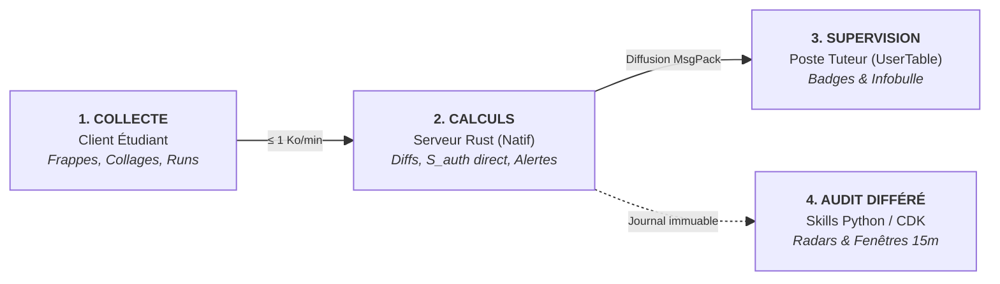
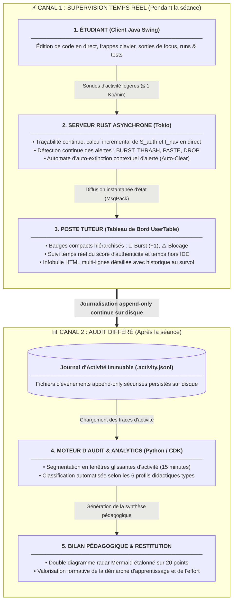
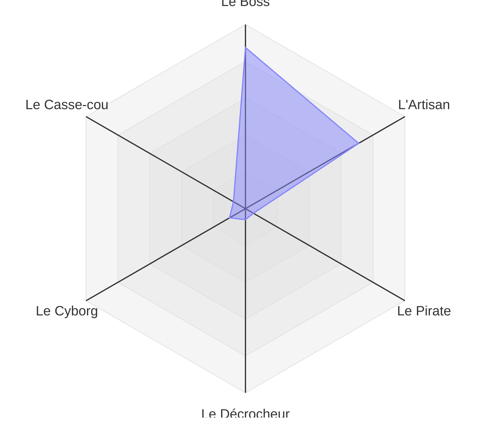

# Système Télémétrique de CodeLab : Observables, Indicateurs et Alertes Temps Réel
> **Documentation Technique et Pédagogique de Référence**  
> *Version du document : 2.1 (Novembre 2026) — CodeLab v1.5.3*

---

## 1. Introduction & Philosophie Architecturale

Le système de traçabilité et d'analyse comportementale de CodeLab répond à un triple défi de l'enseignement contemporain de la programmation :
1. **L'intégrité académique à l'ère des LLM (ChatGPT, Copilot, etc.)** : distinguer une saisie humaine itérative d'une injection massive de code généré par IA ou copié d'un pair.
2. **La remédiation pédagogique proactive** : détecter en temps réel la détresse silencieuse d'un apprenant (acharnement stérile, erreurs répétées en boucle, décrochage) avant qu'il n'abandonne.
3. **L'évaluation formative et continue** : valoriser la démarche de résolution de problèmes et l'effort d'apprentissage (*profil Artisan*) au-delà de la simple conformité du code final.

### Architecture Globale du Flux de Données

Le système sépare clairement l'architecture en deux canaux complémentaires :
1. **Le Canal Temps Réel** (séance de TP) : boucle réactive ultra-légère entre l'étudiant, le serveur Rust et le tuteur.
2. **Le Canal Différé** (après la séance) : analyse longitudinale approfondie à partir du journal inaltérable.

#### Vue Synthétique : Le Pipeline en 3 Temps



#### Vue Fonctionnelle : Les Deux Canaux d'Exploitation



### Principes Fondamentaux de Conception

1. **Faible Empreinte & Performance Critique** :
   - Écriture asynchrone non-bloquante au format *append-only*.
   - Débit réseau inférieur à **1 Ko par minute d'activité** par étudiant.
   - Les calculs d'analyse lourds ne bloquent jamais la boucle d'événements du serveur.
2. **Privacy by Design & Conformité RGPD** :
   - **Aucune interception textuelle arbitraire** : le contenu textuel du presse-papier système de l'OS n'est jamais aspiré ni stocké sur le serveur (aucun risque de fuite de mot de passe ou message privé). Seuls les volumes (nombre de caractères, nombre de lignes insérés) et les horodatages sont conservés.
   - Le code source n'est versionné que lorsqu'il est explicitement écrit dans l'espace de travail du projet.
3. **Résilience et Tolérance aux Pannes** :
   - En cas de redémarrage ou de déconnexion du tuteur, un snapshot complet des alertes actives est immédiatement resynchronisé à la connexion.

---

## 2. Ontologie des 11 Observables Bruts (Collecte)

Les observables constituent le socle factuel et inaltérable de la traçabilité. Ils sont stockés chronologiquement dans `sessions/<session>/<login>/.activity.jsonl`.

### Matrice des Primitives Télémétriques

| Type d'Événement | Origine | Point d'ancrage Code Source | Description & Déclencheur |
| :--- | :---: | :--- | :--- |
| `SESSION` | Serveur | [`handler.rs`](file:///Users/lehuen/dev/codelab/server/server/src/handler.rs) | Connexion (`CONNECTED`) avec IP source ou déconnexion (`DISCONNECTED`) avec durée totale. |
| `VIEW` | Serveur | [`handler.rs`](file:///Users/lehuen/dev/codelab/server/server/src/handler.rs) | Consultation ou ouverture d'un document (sujet Markdown, fichier source, documentation). |
| `FILE_OP` | Serveur | [`handler.rs`](file:///Users/lehuen/dev/codelab/server/server/src/handler.rs) | Manipulation de structure : création (`CREATE`), suppression (`DELETE`), renommage (`RENAME`). |
| `FILE_DROP` | Client | [`AbstractCodeLab.java`](file:///Users/lehuen/dev/codelab/client/src/codelab/AbstractCodeLab.java) | Glisser-déposer d'un fichier externe depuis le bureau de l'OS ou un support amovible. |
| `TYPING` | Client | [`AbstractCodeLab.java`](file:///Users/lehuen/dev/codelab/client/src/codelab/AbstractCodeLab.java) | Frappes réelles cumulées (`typed_chars`) et corrections (`backspaces`) dédupliquées par fenêtre d'édition. |
| `FOCUS` | Client | [`AbstractCodeLab.java`](file:///Users/lehuen/dev/codelab/client/src/codelab/AbstractCodeLab.java) | Alt-Tab ou changement d'application : perte (`LOST`) et reprise (`GAINED`) avec durée d'absence. |
| `PASTE` | Client | [`AbstractCodeLab.java`](file:///Users/lehuen/dev/codelab/client/src/codelab/AbstractCodeLab.java) | Opération Ctrl+V / Cmd+V avec volume de caractères et lignes, qualifié en externe ou interne (`internal: true` si copié depuis CodeLab pour préserver $S_{auth}$). |
| `EDIT` | Serveur | [`activity.rs`](file:///Users/lehuen/dev/codelab/server/server/src/activity.rs) | Diff textuel unifié à la sauvegarde : lignes ajoutées/supprimées, taille du plus grand bloc (`chunk_max`). |
| `COMPILE` | Client | [`AbstractCodeLab.java`](file:///Users/lehuen/dev/codelab/client/src/codelab/AbstractCodeLab.java) | Verdict compilateur (`OK`, `ERROR`), durée de compilation et extrait de diagnostic. |
| `EXECUTE` | Client | [`AbstractCodeLab.java`](file:///Users/lehuen/dev/codelab/client/src/codelab/AbstractCodeLab.java) | Cycle d'exécution (`STARTED`, `DONE`, `ERROR`, `HALTED`), code retour et diagnostic d'erreur/traceback. |
| `HELP` | Serveur | [`handler.rs`](file:///Users/lehuen/dev/codelab/server/server/src/handler.rs) | Cycle d'appel tuteur : demande (`REQUESTED`), annulation (`CANCELLED`), résolution (`RESOLVED`). |

### Schémas JSON Détaillés des Primitives

```json
{"type":"SESSION","timestamp":"2026-11-04T08:00:00Z","session":"TP1","login":"etudiant1","status":"CONNECTED","ip":"172.20.10.42"}
{"type":"VIEW","timestamp":"2026-11-04T08:01:10Z","session":"TP1","login":"etudiant1","file":"enonce.md"}
{"type":"FILE_OP","timestamp":"2026-11-04T08:02:15Z","session":"TP1","login":"etudiant1","op":"CREATE","file":"exercice1.py"}
{"type":"TYPING","timestamp":"2026-11-04T08:05:00Z","session":"TP1","login":"etudiant1","file":"exercice1.py","typed_chars":145,"backspaces":18}
{"type":"FOCUS","timestamp":"2026-11-04T08:12:00Z","session":"TP1","login":"etudiant1","status":"LOST"}
{"type":"FOCUS","timestamp":"2026-11-04T08:13:45Z","session":"TP1","login":"etudiant1","status":"GAINED","duration_sec":105}
{"type":"PASTE","timestamp":"2026-11-04T08:13:48Z","session":"TP1","login":"etudiant1","file":"exercice1.py","chars":380,"lines":18}
{"type":"EDIT","timestamp":"2026-11-04T08:13:52Z","session":"TP1","login":"etudiant1","file":"exercice1.py","total_lines":35,"lines_added":18,"lines_removed":0,"chunk_max":18,"dt_sec":4,"alert":"BURST_INSERT"}
{"type":"FILE_DROP","timestamp":"2026-11-04T08:20:00Z","session":"TP1","login":"etudiant1","file":"helper.py","size_bytes":4096}
{"type":"COMPILE","timestamp":"2026-11-04T08:22:10Z","session":"TP1","login":"etudiant1","file":"main.c","status":"ERROR","error_msg":"undefined reference to `init_buffer'"}
{"type":"EXECUTE","timestamp":"2026-11-04T08:25:00Z","session":"TP1","login":"etudiant1","file":"exercice1.py","status":"ERROR","exit_code":1,"error_msg":"IndexError: list index out of range"}
{"type":"HELP","timestamp":"2026-11-04T08:26:00Z","session":"TP1","login":"etudiant1","status":"REQUESTED"}
{"type":"HELP","timestamp":"2026-11-04T08:29:30Z","session":"TP1","login":"etudiant1","status":"RESOLVED","tutor":"hamdi"}
{"type":"EXECUTE","timestamp":"2026-11-04T08:31:00Z","session":"TP1","login":"etudiant1","file":"exercice1.py","status":"DONE","exit_code":0}
{"type":"SESSION","timestamp":"2026-11-04T10:00:00Z","session":"TP1","login":"etudiant1","status":"DISCONNECTED","duration_sec":7200}
```

---

## 3. Moteur de Dérivation & Indicateurs Pédagogiques

Le moteur d'analytics ([`activity_analyzer.py`](file:///Users/lehuen/dev/codelab/client/codelab.files/skills/activity_analyzer.py)) agrège les observables pour produire des métriques formelles de haut niveau.

### A. Indicateurs d'Intégrité & de Genèse du Code

#### 1. Score d'Authenticité (S_auth)
Mesure la proportion de matière textuelle rédigée via frappe humaine directe face aux injections massives externes :

$$S_{\mathrm{auth}} = \frac{N_{\mathrm{typed}}}{N_{\mathrm{typed}} + N_{\mathrm{pasted}} + N_{\mathrm{dropped}}} \times 100$$

* **Interprétation** :
  * **S_auth ≥ 70%** : **Élevée** (saisie artisanale, appropriation du problème).
  * **40% ≤ S_auth < 70%** : **Modérée** (quelques collages ou réutilisations d'exemples).
  * **S_auth < 40%** : **Suspecte / Faible** (forte prédominance d'injections externes ou génération IA).

#### 2. Indice de Navette Externe (I_nav)
Quantifie la tendance de l'étudiant à travailler hors de l'environnement de développement :

$$I_{\mathrm{nav}} = \frac{\sum t_{\mathrm{away}}}{T_{\mathrm{session}}} \times 100$$

* **Pattern "Prompt IA / Copier-Coller"** :
  `FOCUS(LOST, Δt ∈ [20s, 180s])` ──▶ `FOCUS(GAINED)` ──▶ `PASTE(chars ≥ 150)`
  
  La détection de ce motif **≥ 3 fois** caractérise un cycle de requête de solution externe systématique.

#### 3. Taux de Friction Cognitive (T_fric)
Mesure l'hésitation rédactionnelle et les reprises de code :

$$T_{\mathrm{fric}} = \frac{N_{\mathrm{backspaces}}}{N_{\mathrm{typed}}} \times 100$$

* **T_fric < 3%** : Dictée passive, recopie mécanique sans aucune hésitation.
* **10% ≤ T_fric ≤ 25%** : Rythme normal de réflexion et de réajustement syntaxique.
* **T_fric > 40%** : Tâtonnement aveugle, grande confusion algorithmique.

---

### B. Indicateurs de Méthodologie & Démarche Expérimentale

#### 1. Indice d'Acharnement Stérile (I_thrash)
Représente la part des exécutions ou compilations menées sans réflexion préalable :

$$I_{\mathrm{thrash}} = \frac{\sum \text{Runs en acharnement}}{\text{Total des Runs}} \times 100$$

* **Définition d'un épisode d'acharnement** : séquence d'au moins 3 exécutions consécutives soldées par `ERROR` avec Δt ≤ 30 secondes ou modification textuelle ≤ 5 caractères entre chaque tentative.

#### 2. Temps Moyen de Résolution d'Erreur (TTF — *Time To Fix*)
Durée moyenne écoulée entre l'apparition de la première erreur d'exécution sur un fichier et le retour au premier run `DONE` / `OK` :

$$\overline{\mathrm{TTF}} = \frac{1}{K} \sum_{k=1}^K (t_{\mathrm{resolved}, k} - t_{\mathrm{error}, k})$$

* **TTF moyen < 30 s** : Erreur d'inattention ou typo rapidement corrigée.
* **TTF moyen ∈ [1 min, 5 min]** : Démarche analytique saine de débogage.
* **TTF moyen > 15 min** : Blocage conceptuel sévère nécessitant une intervention.

---

### C. Budget Temps en 4 Quadrants

La durée totale de session est ventilée en 4 dimensions exclusives :

| Quadrant | Intitulé & Événements associés | Part Typique |
| :--- | :--- | :---: |
| **Q1** | **Temps de Lecture / Spécification** (consultation de l'énoncé ou des headers via `VIEW`) | 15% |
| **Q2** | **Temps d'Édition Active** (focus dans l'IDE avec frappe continue `TYPING`) | 45% |
| **Q3** | **Temps de Réflexion / Diagnostic** (focus dans l'IDE sans frappe, pause cognitive) | 25% |
| **Q4** | **Temps Hors IDE** (cumul des périodes d'absence `FOCUS_LOST`) | 15% |

$$\sum_{i=1}^4 Q_i = 100\%$$

---

### D. Dynamique Temporelle par Fenêtres Glissantes (*Sliding Windows*)

Une moyenne globale sur 2 heures peut masquer un basculement tardif vers une IA générative en fin de séance. Le moteur segmente donc la session en tranches continues de Δt = 15 minutes :

$$\mathcal{E}_k = \{ e \in \mathcal{E} \mid t_k \le t(e) < t_k + \Delta t \}$$

Pour chaque tranche temporelle k, le moteur calcule localement :
* **S_auth(k)** : score d'authenticité de la tranche.
* **I_nav(k)** : ratio de temps hors IDE sur la tranche.
* **Typologie de Phase** : qualification algorithmique de l'activité.

#### Matrice de Qualification de Phase

| Phase Qualifiée | Critères de Décision |
| :--- | :--- |
| `✅ Saisie autonome active` | S_auth ≥ 70% et volume de frappe > 80 car/min |
| `⚙️ Validation & Tests` | Runs fréquents (> 2), taux de succès ≥ 60%, S_auth ≥ 60% |
| `📖 Réflexion / Lecture` | Faible frappe (< 30 car), temps de lecture/consultation prédominant |
| `⚠️ Acharnement sur erreurs` | ≥ 3 exécutions consécutives soldées par un échec |
| `🚨 Décrochage IA / Injection` | S_auth < 40% avec présence de `BURST` ou I_nav > 50% |
| `📥 Dépôt externe` | Au moins un événement `FILE_DROP` sur la tranche |

---

## 4. Système d'Indicateurs en Direct, Alertes & Supervision Tuteur

Le serveur Rust évalue en temps réel chaque observable reçu au sein de son module [`activity.rs`](file:///Users/lehuen/dev/codelab/server/server/src/activity.rs). Il maintient pour chaque étudiant un état d'indicateurs dynamiques (`StudentLiveStatus` / `LiveMetrics`) et une collection d'alertes en mémoire (`HashMap<String, LiveAlert>`).

### A. Indicateurs Calculés en Direct par le Serveur Rust

Sans dépendre d'aucun interpréteur externe, le serveur calcule de manière incrémentale :
* **Score d'Authenticité en direct (S_auth)** : rapport continu entre les caractères issus de la frappe clavier réelle et le volume total intégrant collages et bursts.
* **Taux de Navette Hors IDE (I_nav)** : ratio de temps passé hors focus applicatif par rapport à la durée totale écoulée.
* **Compteur d'Acharnement** : suivi des échecs consécutifs sans succès intermédiaire.
* **Replay Résilient** : en cas de reconnexion d'un étudiant ou de redémarrage du serveur, l'état `StudentLiveStatus` est automatiquement reconstruit en quelques millisecondes à partir du journal local `.activity.jsonl`.

Ces indicateurs sont transmis aux postes superviseurs dans la structure `UserData` (`s_auth`, `i_nav`) et consultables en temps réel dans l'infobulle de chaque étudiant.

### B. Matrice des Alertes Détectées en Flux Continu

| Code Alerte | Niveau de Sévérité | Condition de Déclenchement | Règle d'Extinction (*Auto-Clear*) |
| :---: | :---: | :--- | :--- |
| `BURST` | `CRIT` | ≥ 20 lignes insérées en ≤ 15s (`BURST_INSERT`) ou nouveau fichier créé avec ≥ 25 lignes d'un coup (`BURST_NEW_FILE`). | Acquittement manuel par le tuteur au poste. |
| `PASTE` | `WARN` | Collage externe ≥ 15 lignes ou ≥ 400 caractères (les collages internes propres avec `internal: true` ne déclenchent pas d'alerte). | Acquittement manuel par le tuteur au poste. |
| `THRASH` | `WARN` | ≥ 3 compilations `ERROR` ou exécutions `ERROR` consécutives sans run réussi intercalé. | **Auto-extinction automatique** dès :<br>1. Compilation réussie (`status: OK`)<br>2. Exécution réussie (`status: DONE`)<br>3. Modification de code ≥ 3 lignes. |
| `DROP` | `WARN` | Dépôt externe de fichier dans l'arborescence du projet via drag & drop. | Acquittement manuel par le tuteur au poste. |

### Gestion Multi-Alertes & Hiérarchie de Sévérité

Pour éviter qu'une alerte secondaire ne masque une alerte critique (ex: un collage mineur `PASTE` recouvrant une injection massive `BURST`), l'état étudiant consolide l'ensemble des alertes actives :

| Échelon | Rôle & Structure | Comportement & Rendu |
| :--- | :--- | :--- |
| **Stockage Mémoire** | `HashMap<String, LiveAlert>` | Cumul non-destructif de toutes les alertes simultanées par étudiant. |
| **Priorité de Sévérité** | `CRIT (1) > WARN (2) > INFO (3)` | Sélection du statut le plus urgent pour déterminer la couleur de la cellule. |
| **Présentation IHM** | Badge compact `UserTable` | Affichage du picto prioritaire et du compteur résiduel : `🚨 Burst (+1)`. |

1. **Hiérarchie Stricte** : `CRIT > WARN > INFO`.
2. **Badge Compact** : affiche le pictogramme et l'intitulé de l'alerte la plus prioritaire, augmenté d'un compteur d'alertes résiduelles s'il y en a plusieurs (ex: `🚨 Burst (+1)` ou `⚠️ Blocage (+2)`).
3. **Coloration Dynamique de Cellule** :
   - Fond **rouge clair** / texte **rouge vif** si au moins une alerte `CRIT` est active.
   - Fond **ambre clair** / texte **orange foncé** si uniquement des alertes `WARN` sont actives.

### Spécification du Protocole Réseau (MsgPack)

La communication bidirectionnelle entre le serveur Rust et les clients de supervision tuteurs s'effectue par des messages légers encodés en MessagePack :

#### 1. Diffusion d'une Alerte : `SET_USER_ALERT`
Diffusé en broadcast asynchrone Tokio à tous les tuteurs connectés de la session :

```json
{
  "command": "SET_USER_ALERT",
  "login": "etudiant1",
  "alerts_json": "{\"BURST\":{\"kind\":\"BURST\",\"level\":\"CRIT\",\"message\":\"+35L insérées d'un bloc (tp1.py)\",\"timestamp\":\"14:22:15\"},\"THRASH\":{\"kind\":\"THRASH\",\"level\":\"WARN\",\"message\":\"3 échecs consécutifs d'exécution\",\"timestamp\":\"14:25:30\"}}"
}
```

#### 2. Réinitialisation / Acquittement : `RESET_USER_ALERT`
* **Envoyé par le tuteur** lors d'un clic droit pour acquitter :
  ```json
  { "command": "RESET_USER_ALERT", "login": "etudiant1", "kind": "ALL" }
  ```
* **Diffusé par le serveur** aux autres tuteurs pour synchroniser la suppression d'une alerte éteinte :
  ```json
  { "command": "RESET_USER_ALERT", "login": "etudiant1", "kind": "THRASH" }
  ```

---

## 5. Interface Tuteur & Expérience Utilisateur (`UserTable`)

La supervision en classe s'opère via la table des étudiants ([`UserTable.java`](file:///Users/lehuen/dev/codelab/client/src/codelab/modules/editeur/usertable/UserTable.java)).

| Étudiant | Groupe | Connecté | Activité | Alerte (5e colonne) |
| :--- | :---: | :---: | :---: | :--- |
| **lmartin** | G1 | En ligne | Il y a 10s | `🚨 Burst (+1)` *(fond rouge)* |
| **tdubois** | G1 | En ligne | Il y a 4s | `⚠️ Blocage` *(fond ambre)* |
| **lbernard** | G2 | En ligne | Il y a 1m | `📋 Paste` *(fond ambre)* |
| **cpetit** | G2 | En ligne | Il y a 15s | — *(neutre)* |

### Infobulle HTML Enrichie

Au survol de la cellule Alerte d'un étudiant, une infobulle HTML dynamique affiche l'inventaire chronologique et détaillé de toutes les anomalies actives :

```html
<html>
  <body style='font-family:sans-serif; margin:2px;'>
    <b>Alertes actives (2) :</b><br/>
    • <font color='#c0392b'><b>🚨 BURST (14:22:15)</b></font> : +35L insérées d'un bloc (tp1.py)<br/>
    • <font color='#d35400'><b>⚠️ THRASH (14:25:30)</b></font> : 3 échecs consécutifs d'exécution
  </body>
</html>
```

### Interaction Tuteur (Acquittement Contextuel)

* **Menu Clic Droit** : L'enseignant clique sur l'étudiant dans la liste et sélectionne :
  > **« Acquitter les alertes de [Nom] (2) »**
* **Comportement Réseau** : L'IHM envoie immédiatement `RESET_USER_ALERT` au serveur, qui purge le statut mémoire et propage l'extinction à l'ensemble des tuteurs de la salle, signalant que l'étudiant a été pris en charge.

---

## 6. Typologie des Profils Étudiants & Visualisation Radar

L'audit de post-traitement classe automatiquement les étudiants selon 6 profils didactiques types articulés autour de la matrice d'authenticité et de vélocité de résolution, et les projette sur un **diagramme radar Mermaid (`radar-beta`)** où les comportements sont opposés deux à deux à 180° :

```
             👑 Le Boss (12h)
                   ▲
  ⚡ Le Casse-cou  │  🔨 L'Artisan (2h)
        (10h) \    │    /
               \   │   /
    ────────────┼────────────
               /   │   \
        (8h)  /    │    \  (4h)
    🤖 Le Cyborg   │  🏴‍☠️ Le Pirate
                   ▼
          🚪 Le Décrocheur (6h)
```

### A. Les 3 Couples de Profils Didactiques Opposés à 180°

| Couple d'Opposés | Profil Type | Caractéristiques & Comportement Observé | Indicateurs Clés |
| :--- | :--- | :--- | :--- |
| **Axe 0 $\longleftrightarrow$ Axe 3**<br>*(Aisance vs Abandon)* | 👑 **Le Boss** | Résolution immédiate, autonomie complète, maîtrise conceptuelle sans friction. | $S_{auth} > 80\%$, $TTF < 30\,\text{s}$, $I_{thrash} = 0$, $0$ aide tuteur. |
| | 🚪 **Le Décrocheur** | Difficulté non résolue, passivité, inactivité prolongée et abandon silencieux. | Périodes Idle $> 15\,\text{min}$, Hors IDE $> 40\%$, $\le 2$ runs. |
| **Axe 1 $\longleftrightarrow$ Axe 4**<br>*(Authenticité vs IA)* | 🔨 **L'Artisan** | Démarche d'apprentissage exemplaire, saisie personnelle, cycles itératifs courts. | $S_{auth} > 80\%$, $T_{fric} \in [10\%, 25\%]$, $I_{thrash} < 10\%$. |
| | 🤖 **Le Cyborg** | Délégation externe / IA, injections massives de blocs sans maturation. | $S_{auth} < 30\%$, alertes `BURST` multiples, $I_{nav} > 40\%$. |
| **Axe 2 $\longleftrightarrow$ Axe 5**<br>*(Copie vs Acharnement)* | 🏴‍☠️ **Le Pirate** | Collusion directe en salle, import par support externe (USB/réseau) ou copie d'autrui. | Présence d'événements `FILE_DROP`, similarité Jaccard/Winnowing $\ge 75\%$. |
| | ⚡ **Le Casse-cou** | Combat acharné avec le compilateur, tâtonnement compulsif sans recul ni diagnostic. | $I_{thrash} > 35\%$, erreurs $> 70\%$, $\Delta t$ entre runs $< 15\,\text{s}$. |

---

### B. Le Double Radar Individuel (Fiche Étudiant)

Chaque rapport individuel présente côte à côte deux diagrammes radar complémentaires au format Mermaid (`radar-beta`), intégrés dans un tableau HTML5 responsive sans bordure :

1. **Radar des Indicateurs Clés (/20)** : évalue les 6 dimensions techniques objectives :
   - `auth` : Authenticité ($S_{auth}$)
   - `focus` : Concentration ($100 - I_{nav}$)
   - `debug` : Efficience de débogage ($1 - I_{thrash}$)
   - `test` : Tests & Validation
   - `arch` : Architecture & Conception
   - `style` : Style & Conventions (PEP 8 / syntaxe)
2. **Radar des Profils Types (/20)** : évalue l'affinité comportementale de l'étudiant selon les 6 archétypes opposés deux à deux :
   - `axis boss["Le Boss"], artisan["L'Artisan"], pirate["Le Pirate"], decroch["Le Décrocheur"], cyborg["Le Cyborg"], casse["Le Casse-cou"]`



---

### C. Le Radar de Cohorte (Rapport de Synthèse de Promotion)

Dans le rapport de synthèse de promotion (`synthese_*.md`), le tableau des clusters d'étudiants types est immédiatement suivi du **Radar de Cohorte**. Il synthétise en un seul coup d'œil la santé globale de la promotion en reportant le **nombre d'étudiants rattachés à chaque profil type** sur les mêmes 3 axes opposés deux à deux, avec une échelle maximale dynamique ajustée aux effectifs.

---

### D. Détail des 6 Profils Didactiques

#### 1. L'Artisan (Comportement d'Apprentissage Exemplaire)
* **Indicateurs** : S_auth > 80%, T_fric ∈ [10%, 25%], I_thrash < 10%.
* **Démarche** : Cycles de développement courts et incrémentaux, lecture approfondie du sujet avant de coder, résolution méthodique des erreurs étape par étape.

#### 2. Le Boss (Expertise et Maîtrise Directe)
* **Indicateurs** : S_auth > 80%, TTF < 30 s, zéro demande d'aide tuteur, cadence de frappe élevée.
* **Démarche** : L'étudiant maîtrise parfaitement les concepts et déroule la solution sans friction notable.

#### 3. Le Cyborg (Assistance IA / Solution Importée)
* **Indicateurs** : S_auth < 30%, alertes `BURST` multiples, I_nav > 40%, T_fric < 5%.
* **Démarche** : Absence de genèse itérative du code. L'étudiant formule des requêtes sur un modèle externe et injecte des blocs complets de 30 à 60 lignes sans les retoucher.

#### 4. Le Casse-Cou (Acharnement Stérile / Tâtonnement Aveugle)
* **Indicateurs** : I_thrash > 35%, ratio d'erreurs d'exécution > 70%, Δt entre runs < 15 s.
* **Démarche** : L'étudiant ne consulte pas la sortie console ni le traceback. Il modifie un caractère au hasard et relance en boucle en espérant un résultat positif.

#### 5. Le Décrocheur (Perte de Pied et Abandon Silencieux)
* **Indicateurs** : Temps hors IDE > 50%, périodes d'inactivité > 15 min, moins de 3 runs sur l'ensemble de la séance.
* **Démarche** : Face à une difficulté initiale non résolue, l'étudiant renonce à chercher et attend la fin de séance sans solliciter l'encadrement.

#### 6. Le Pirate (Collusion en Salle / Import Direct)
* **Indicateurs** : Présence d'événements `FILE_DROP`, corrélation de synchronicité (≤ 90 s) avec la réussite d'un poste voisin.
* **Démarche** : Récupération directe d'un fichier source par clé USB, partage local ou messagerie instantanée.

---

### E. Détection & Interprétation des Doubles-Profils Didactiques Cohérents

En situation réelle d'apprentissage en laboratoire, les comportements observés ne se réduisent que rarement à un archétype unilatéral pur. Les 6 profils didactiques de CodeLab étant bâtis sur 3 axes orthogonaux indépendants, les croisements inter-axes traduisent des **signatures comportementales complexes et cohérentes**.

#### 1. Principes et Démarche Didactique
Un double-profil didactique n'est pas un artefact statistique, mais la manifestation simultanée de deux dimensions comportementales indépendantes :
- **La maîtrise conceptuelle et algorithmique** (Axe Boss $\longleftrightarrow$ Décrocheur)
- **La démarche d'assimilation et d'effort personnel** (Axe Artisan $\longleftrightarrow$ Cyborg)
- **La gestion émotionnelle et stratégique de l'erreur** (Axe Casse-cou $\longleftrightarrow$ Pirate)

L'intérêt didactique majeur réside dans la **finesse du diagnostic** : par exemple, un étudiant qui présente à la fois des traits d'*Artisan* et de *Casse-cou* (*« Le Travailleur Acharné »*) n'a pas du tout besoin du même accompagnement qu'un *Casse-cou* qui injecte du code IA (*« L'Apprenti Sorcier »*). Dans le premier cas, l'enseignant doit débloquer la méthode de débogage tout en valorisant l'effort authentique ; dans le second, un recadrage déontologique et méthodologique immédiat s'impose.

#### 2. Règles Formelles de Détection Algorithmique
Le moteur d'audit [`activity_analyzer.py`](file:///Users/lehuen/dev/codelab/client/codelab.files/skills/activity_analyzer.py) identifie automatiquement un **Double-Profil Hybride** lorsque les trois conditions cumulatives suivantes sont satisfaites :

1. **Orthogonalité des dimensions** : Les deux profils avec les affinités les plus fortes ($P_1$ et $P_2$) appartiennent à des axes différents. Les pôles opposés d'un même axe à 180° (*Boss vs Décrocheur*, *Artisan vs Cyborg*, *Casse-cou vs Pirate*) s'excluent mutuellement par construction métrique et ne peuvent former un double-profil harmonieux.
2. **Niveau d'affinité significatif** : Les deux scores d'affinité sont élevés ($S_1 \ge 11.0 / 20$ et $S_2 \ge 11.0 / 20$, soit au moins 55% d'adéquation comportementale).
3. **Proximité des affinités** : L'écart entre les deux scores est resserré ($|S_1 - S_2| \le 3.5\text{ pts}$), garantissant que les deux dimensions sont au coude-à-coude et motrices dans la séance.

Si l'écart est supérieur à 3.5 points, l'étudiant conserve son statut de profil dominant unique (avec simple composante secondaire mentionnée si $S_2 \ge 10.0$).

#### 3. Matrice des 12 Doubles-Profils Didactiques Hybrides

| Double-Profil Détecté | Surnom Pédagogique | Signification Didactique & Posture Observée | Posture & Conseil pour l'Enseignant |
| :--- | :--- | :--- | :--- |
| **👑 Boss + 🔨 Artisan** | **L'Architecte Méthodique** | **Le profil d'excellence absolue** : aisance théorique immédiate combinée à une rigueur de construction pas à pas (saisie personnelle continue, commits réguliers, tests propres). L'étudiant conçoit avec facilité sans survoler le travail. | Valoriser son autonomie, lui proposer des défis d'optimisation avancés, de la généricité ou un rôle de tuteur d'îlot pour stimuler ses pairs. |
| **👑 Boss + ⚡ Casse-cou** | **Le Hacker Instinctif** | Grande vivacité d'esprit et aisance algorithmique, mais méthode de développement impulsive. Enchaîne les modifications et les runs à chaud sans plan écrit, comptant sur son intuition pour corriger en direct. | Canaliser sa vivacité vers des pratiques d'ingénierie logicielle pérennes : poser des assertions, structurer un plan de tests et documenter ses interfaces. |
| **🔨 Artisan + ⚡ Casse-cou** | **Le Travailleur Acharné** | Investissement authentique remarquable et combativité totale (zéro triche, forte saisie manuelle), mais démarche pénalisée par le tâtonnement aveugle face aux erreurs bloquantes. | **Profil prioritaire pour le tuteur** : l'aider à décortiquer les tracebacks d'erreurs, poser des points d'arrêt et verbaliser son algorithme avant de relancer le compilateur. |
| **🤖 Cyborg + ⚡ Casse-cou** | **L'Apprenti Sorcier** | Combinaison instable d'injections de code externe/IA et d'acharnement compulsif. L'étudiant injecte des blocs non maîtrisés, puis modifie des bribes au hasard pour tenter de faire passer les tests. | Recadrage pédagogique immédiat : suspendre temporairement les outils d'assistance, exiger un retour aux fondamentaux et une réécriture manuelle pas à pas avec verbalisation. |
| **🚪 Décrocheur + 🤖 Cyborg** | **Le Délégataire Passif** | Difficultés ou passivité en séance masquées par le recours opportuniste à l'IA. L'étudiant reste inactif de longues périodes, puis parachute une solution externe complète d'un seul coup en fin de TP. | Entretien individuel bienveillant mais ferme : vérifier l'assimilation réelle par une soutenance orale et proposer une remédiation pas à pas sur les concepts fondamentaux. |
| **🚪 Décrocheur + ⚡ Casse-cou** | **L'Épuisé Découragé** | Épuisement face aux échecs répétés. L'étudiant a d'abord lutté intensément en début de session (runs en boucle, frustration), avant de baisser les bras et de basculer dans l'inactivité prolongée. | Signe de détresse didactique : intervenir plus précocement en séance dès les premiers signes d'acharnement stérile pour éviter le renoncement. |
| **👑 Boss + 🤖 Cyborg** | **L'Ingénieur Augmenté** | Forte maîtrise conceptuelle mise au service d'un copilotage IA assumé comme accélérateur de productivité. L'étudiant pilote l'outil mais risque de s'affranchir de l'effort d'implémentation fine. | S'assurer lors d'évaluations sur table ou d'oraux que la compétence de codage en autonomie complète sans assistance reste parfaitement acquise. |
| **🏴‍☠️ Pirate + 🤖 Cyborg** | **Le Contrebandier Numérique** | Cumul de ruptures d'intégrité : importations de fichiers externes (clé USB), partage réseau et code généré par IA. L'authenticité de production personnelle est quasi inexistante. | Convocation pour manquement à la charte d'intégrité académique et nouvelle évaluation en conditions strictement surveillées. |
| **👑 Boss + 🏴‍☠️ Pirate** | **L'Éclaireur Partageur** | Aisance technique indiscutable associée à des flux de partage de fichiers ou de code vers des pairs. L'étudiant maîtrise le sujet mais diffuse ou importe des ressources non autorisées. | Rappeler le cadre déontologique : faire la distinction entre tutorat bienveillant et diffusion/collusion directe en évaluation. |
| **🚪 Décrocheur + 🏴‍☠️ Pirate** | **Le Copiste de Survie** | Démuni face au sujet et inactif, l'étudiant a importé la solution d'un voisin par clé USB ou partage réseau pour éviter la feuille blanche. | Traiter la cause didactique racine (blocage complet) tout en appliquant le règlement pédagogique sur la fraude. |
| **🔨 Artisan + 🏴‍☠️ Pirate** | **L'Artisan Sous Influence** | L'étudiant a fourni un travail personnel appliqué sur une partie du sujet, mais a complété une fonction manquante par un emprunt externe direct. | Valoriser la partie authentique produite tout en invalidant le fragment collusoire pour encourager la persévérance honnête. |
| **🔨 Artisan + 🚪 Décrocheur** | **L'Apprenti Hésitant** | Démarche artisanale soignée lorsqu'il est actif, mais progression ralentie par de longs moments d'hésitation ou de doute où il n'ose plus avancer. | Stimuler la confiance en soi, dédramatiser les erreurs d'exécution et fixer des micro-objectifs pour rythmer la séance. |

#### 4. Restitution dans les Fiches Individuelles et Bilans de Cohorte
Lorsqu'un double-profil est identifié :
- **Dans la fiche individuelle d'évaluation** (`*_rapport.md`) :
  - La note finale affiche l'intitulé combiné et le surnom didactique :  
    `| **NOTE FINALE** | **18.3** | **/ 20.0** | **Profil : Le Boss + L'Artisan (L'Architecte Méthodique)** |`
  - Un encadré pédagogique dédié explicite la posture constatée et les conseils d'action pour l'enseignant.
  - Dans le tableau récapitulatif d'affinité, les deux profils moteurs sont labellisés `🟢 Double-profil actif`.
- **Dans le rapport de synthèse de promotion** (`synthese_*.md`) :
  - Le tableau récapitulatif des étudiants reporte le double-profil dans la colonne *Profil Dominant*.
  - Une section dédiée intitulée `## 🧬 Analyse des Profils Hybrides & Doubles-Profils Remarquables` dresse l'inventaire des étudiants hybrides de la promotion avec le diagnostic croisé.

---

## 7. Guide d'Exploitation pour les Enseignants & Tuteurs

### Pendant la Séance (Pilotage Temps Réel)
1. **Prioriser les passages au poste** :
   - Surveiller en premier lieu les badges **`⚠️ Blocage` (`THRASH`)** : ils signalent des étudiants qui travaillent activement mais sont coincés dans une impasse conceptuelle.
   - Vérifier les badges **`🚨 Burst`** : un rapide coup d'œil permet de s'assurer que l'étudiant est capable d'expliquer oralement les 30 lignes qu'il vient d'insérer.
2. **Utiliser l'Auto-Acquittement** :
   - Il n'est pas nécessaire d'acquitter manuellement les alertes de blocage : si l'étudiant comprend votre conseil et réussit son run suivant, l'alerte s'éteint automatiquement dans les 2 secondes sur votre écran.

### Après la Séance (Bilan d'Audit & Évaluation)
1. **Lancer l'Analyseur** :
   ```bash
   python3 client/codelab.files/skills/activity_analyzer.py sessions/2026-TP1/
   ```
2. **Consulter les Fenêtres Glissantes** :
   - Le tableau chronologique des tranches de 15 minutes permet d'identifier à la minute près l'instant de bascule vers une IA générative (chute brutale de S_auth).
3. **Exploitation Pédagogique des Doubles-Profils** :
   - Cibler immédiatement les *Travailleurs Acharnés* (Artisan + Casse-cou) pour une séance de consolidation sur les méthodes de débogage et l'inspection de variables.
   - Convoquer en entretien d'explication les profils *Apprenti Sorcier* (Cyborg + Casse-cou) et *Délégataire Passif* (Décrocheur + Cyborg) afin de rétablir une posture active de codage.
4. **Valorisation à l'Évaluation** :
   - Deux étudiants obtenant la note de 14/20 aux tests unitaires automatiques peuvent être différenciés : accorder un bonus de démarche à un profil *Artisan* persévérant, et conditionner la note d'un profil *Cyborg* à une soutenance orale d'explication du code.

