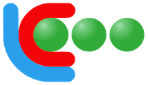

# CodeLab Documentation

Welcome to the official documentation for the **CodeLab** programming environment.

  

> ⚡ **New to CodeLab?** Check out the [**Quickstart Guide**](quickstart/quickstart-en.md) to launch the environment and run your first program in under 2 minutes!

## Language API References

- [**C Language**](lang-c/doc-c-en.md): Imperative, procedural, compiled, and statically typed language.
- [**Java Language**](lang-java/doc-java-en.md): Imperative, object-oriented language compiled to bytecode.
- [**Python Language**](lang-python/doc-py-en.md): Multi-paradigm, interpreted, and dynamically typed language.
- [**CLIPS Language**](lang-clips/doc-clips-en.md): Declarative, rule-based language designed for expert systems.

## Developer Tutorials (Application Modules)

- [**Tutorial #1: Designing a First Module**](tuto1/tuto1-en.md): PAC architecture (Presentation-Abstraction-Control).
- [**Tutorial #2: Designing a 2D Plotter Module**](tuto2/tuto2-en.md): Vector drawing interface (line segments and circles).
- [**Tutorial #3: Designing a Motor Simulator**](tuto3/tuto3-en.md): Real-time simulation and closed-loop motor control.
