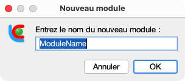
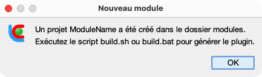
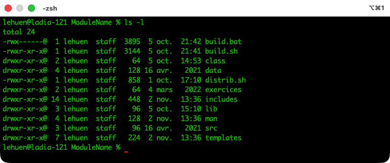
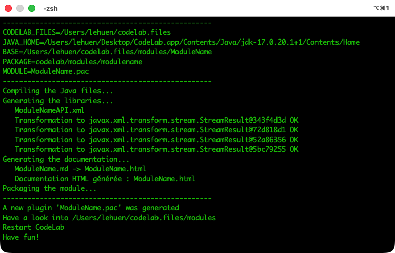

# Modules Applicatifs CodeLab

CodeLab permet d'enrichir l'environnement d'apprentissage à l'aide de **modules applicatifs** (plugins distribués sous l'extension `.pac` pour *Plugin Applicatif CodeLab*, également fondés sur le modèle architectural *Présentation - Abstraction - Contrôle*). Chaque module associe une interface graphique interactive (IHM) et une interface de programmation (API) accessible dans tous les langages supportés par CodeLab (C, Go, Java, Python, CLIPS, etc.).

---

## 1. Installer un plugin (`.pac`)

Pour utiliser un module déjà compilé :

1. Téléchargez le fichier `.pac` correspondant dans la table ci-dessous (ou dans le dossier [downloads/](downloads/)).
2. Placez le fichier `.pac` directement dans le dossier `modules/` de votre installation CodeLab (ou dans `client/modules/` pour les sources).
3. Relancez CodeLab : le nouveau module apparaît dans le menu des modules et fournit des modèles de code (*templates*) prêts à l'emploi pour chaque langage supporté.

---

## 2. Plugins disponibles

Les archives téléchargeables ci-dessous contiennent les plugins prêts à l'emploi (`.pac`) ainsi que les archives sources complètes (`.zip`) :

| Module Applicatif | Code source | Plugin | Taille (`.pac`) |
| :--- | :---: | :---: | :---: |
| **Exemple du [premier tutoriel](https://jlehuen.github.io/CodeLab/doc-fr/tuto1/tuto1-fr/)** : module *Hello World* | [HelloModule.zip](downloads/HelloModule.zip) | [HelloModule.pac](downloads/HelloModule.pac) | ~30 Ko |
| **Exemple du [deuxième tutoriel](https://jlehuen.github.io/CodeLab/doc-fr/tuto2/tuto2-fr/)** : module de tracé en 2D | [DrawingModule.zip](downloads/DrawingModule.zip) | [DrawingModule.pac](downloads/DrawingModule.pac) | ~29 Ko |
| **Exemple du [troisième tutoriel](https://jlehuen.github.io/CodeLab/doc-fr/tuto3/tuto3-fr/)** : simulateur de moteur NXT | [MotorModule.zip](downloads/MotorModule.zip) | [MotorModule.pac](downloads/MotorModule.pac) | ~887 Ko |
| **Laboratoire de tris** : visualiseur d'algorithmes (bubble sort, quick sort, etc.) | [SortingModule.zip](downloads/SortingModule.zip) | [SortingModule.pac](downloads/SortingModule.pac) | ~36 Ko |
| **Atelier graphique** : version plugin du module tortue vectorielle (Logo) | [TurtleModule.zip](downloads/TurtleModule.zip) | [TurtleModule.pac](downloads/TurtleModule.pac) | ~72 Ko |
| **Robot industriel 5 axes CoreTech 3D** : bras articulé en 3D temps réel | [Robot3DModule.zip](downloads/Robot3DModule.zip) | [Robot3DModule.pac](downloads/Robot3DModule.pac) | ~15,6 Mo |
| **Le Donjon Algorithmique** : labyrinthes, clés, portes et trésors (recherche de chemin, IA, main droite) — [Guide didactique](downloads/DungeonModule/README.md) | [DungeonModule.zip](downloads/DungeonModule.zip) | [DungeonModule.pac](downloads/DungeonModule.pac) | ~134 Ko |

---

## 3. Compiler un plugin (`.zip`)

Si vous souhaitez modifier le code d'un module ou le recompiler :

1. Téléchargez l'archive source `.zip` du module.
2. Décompressez-la dans le dossier `CDK` (*CodeLab Development Kit*, situé dans `client/codelab.files/hidden/CDK/` ou à la racine de la distribution installée).
3. Ouvrez un terminal dans le dossier du module extrait et exécutez le script :
   - Sous Linux / macOS : `./build.sh`
   - Sous Windows : `build.bat`
4. Le fichier `.pac` est automatiquement généré et déployé dans le dossier `modules/` de CodeLab.
5. Relancez CodeLab.

---

## 4. Créer un nouveau plugin avec le CDK

Pour concevoir un nouveau module applicatif interactif, vous pouvez suivre les **tutoriels développeur pas à pas** :

- 📖 **[Tutoriel 1 : Conception d'un premier module CodeLab](https://jlehuen.github.io/CodeLab/doc-fr/tuto1/tuto1-fr/)**
	- découverte du CDK et de l'architecture PAC
	- création d'un premier module *Hello World*
	- déclaration XML de l'API et premier build
- 📖 **[Tutoriel 2 : Conception d'un module de tracé 2D](https://jlehuen.github.io/CodeLab/doc-fr/tuto2/tuto2-fr/)**
	- IHM graphique personnalisée
	- gestion des requêtes clientes
	- mise en œuvre d'une API de dessin 2D
- 📖 **[Tutoriel 3 : Conception d'un simulateur de moteur NXT](https://jlehuen.github.io/CodeLab/doc-fr/tuto3/tuto3-fr/)**
	- simulateur temps réel multithreadé
	- asservissement et tableau de bord interactif

### Étapes rapides avec le CDK :

1. **Génération du squelette depuis CodeLab** :
   Dans CodeLab, sélectionnez l'élément de menu **Modules > Générer un nouveau module** et saisissez le nom de votre module (par exemple `ModuleName`) :

   

     
   

   Après validation, un message confirme la création du projet et le dossier `modules/ModuleName/` s'ouvre automatiquement dans votre gestionnaire de fichiers :

   

     
   

   > 💡 *Alternative en ligne de commande* : vous pouvez également ouvrir un terminal dans le répertoire `CDK` et exécuter `./newmodule.sh <Nom>` (sous Linux/macOS) ou `newmodule.bat <Nom>` (sous Windows).

2. **Arborescence du projet généré** :
   Dans le terminal, le dossier `modules/ModuleName/` contient l'ensemble de l'arborescence prête à l'emploi :

   

     
   

   Les fichiers clés à éditer pour développer un module sont :
   - `src/codelab/modules/modulename/ModuleName.java` : IHM principale et logique applicative Swing.
   - `src/codelab/modules/modulename/ModuleNameToolbar.java` : barre d'outils et contrôles interactifs.
   - `includes/ModuleNameAPI.xml` : description de l'API au format XML pour génération automatique des librairies.
   - `man/ModuleName.md` : documentation du module en Markdown pour le manuel HTML intégré au fichier .pac

3. **Compilation et assemblage du plugin** :
   Depuis le dossier `modules/ModuleName/`, exécutez le script de compilation :
   - Sous Linux / macOS : `./build.sh`
   - Sous Windows : `build.bat`

   

     
   

   Ce script compile le code Java, génère les bibliothèques et documentations d'API multi-langages, convertit le manuel d'atelier Markdown, assemble l'archive **`.pac`** (`ModuleName.pac`) et la déploie automatiquement dans le dossier `modules/` de CodeLab.

4. **Test dans CodeLab** :
   Relancez CodeLab pour tester votre nouveau module : il apparaît dans le sélecteur d'ateliers et ses templates d'API sont automatiquement disponibles pour chaque langage supporté.
